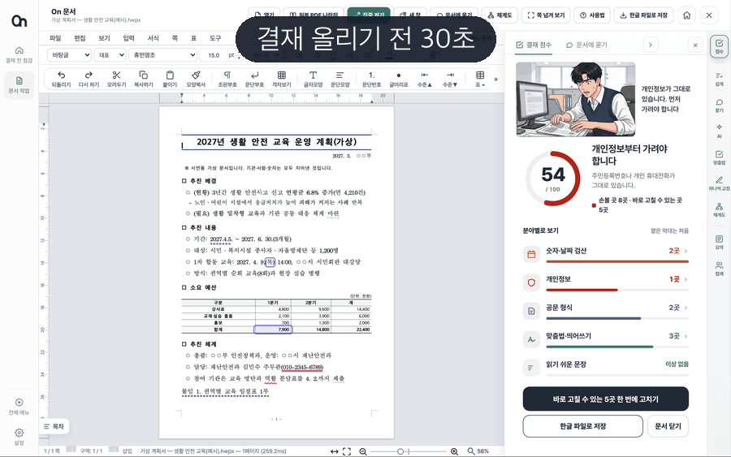
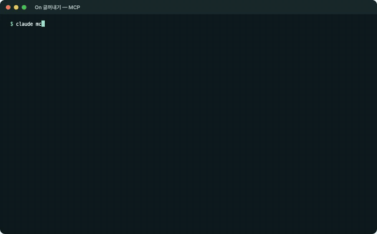
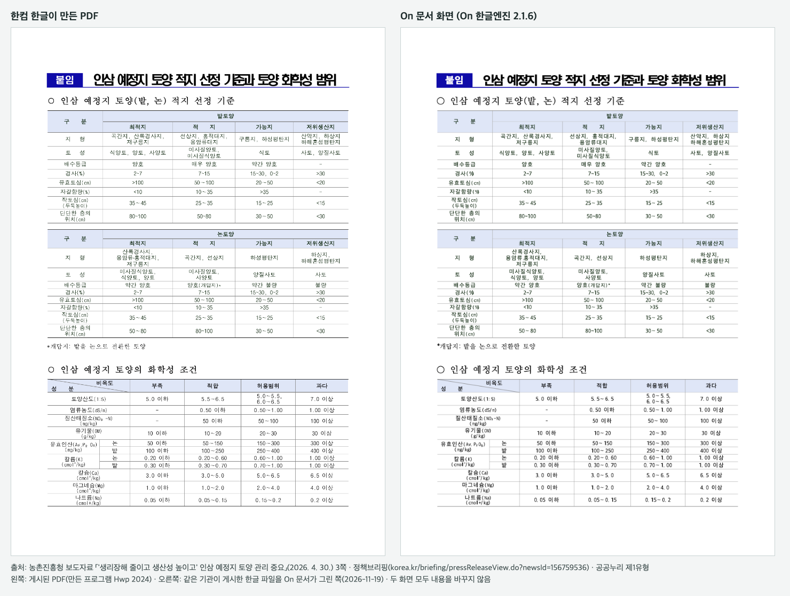
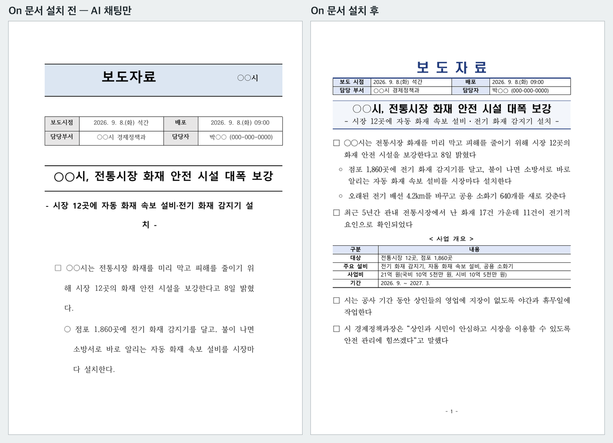

<p align="center">
  
</p>

# On 문서 — 쓰기부터 결재 전 점검까지

한글(HWP·HWPX)·PDF·오피스 문서를 브라우저에서 열어 보고 고치고, 원고나 AI 채팅의 글을 **정부 공문서 꼴 한글 보고서·계획서**(표지·목차·장 제목·표·그래프·체계도까지)로 만들어 주며, 결재 전에 공문서 형식·숫자·개인정보·보안 표시를 점검하는 웹 서비스입니다. 한글 프로그램이 깔려 있지 않은 PC·맥·휴대폰에서도 쓰고, 점검과 고치기는 AI 없이 됩니다. 공공 분야 현장에서 일하며 만든 문서 도구이고, 지금은 시범판입니다. 로그인 없이 손님으로 바로 써 볼 수 있습니다.

> On 문서 (On Document) is a browser-based tool to open, edit, and check Korean HWP/HWPX, PDF, and Office documents before approval, without the Hancom word processor. Checks run without AI. This repository holds the guide only; the service source is not public.

<p align="center">
  <a href="https://onmunseo.kr/app/"><b>웹에서 바로 쓰기</b></a>
  &nbsp;·&nbsp;
  <a href="#ai-도구에-붙이기mcp플러그인"><b>AI 도구에 붙이기(MCP·플러그인)</b></a>
</p>

| 점수 | 무엇을 잰 값인가 |
|:---:|---|
| **29,947개** | 지금까지 시험·분석한 공개 문서 파일 — 공공기관 422곳의 한글·오피스·PDF 문서 19,021개와 그 짝으로 쓴 한컴 PDF 10,077개, 글자 인식 시험 쪽 849개(9만 2천 쪽 이상, 같은 파일은 한 번만 셈). 이와 별도로 비공개 실무 문서 1,972개도 시험(2026-11-22 집계) |
| **0.970** | 영어 PDF 공개 벤치마크(200쪽) 공식 채점기 종합 — **공식 순위표 최고 0.907**(엔진 14개). 개발 때 보지 않은 125쪽만 재도 0.970 |
| **100점** | On 문서로 만든 공문서 30종을 한컴오피스 한글 2024 로 열어 채점 — 30종 모두 100점 |
| **98.7%** | 쪽 수까지 한컴과 같은 한글 문서 — 공공 문서 6,898개 중 6,810개(복잡한 공공 문서·보도자료·법령 별표) |
| **0.981** | 한글(HWPX) 파일 속 표를 칸 나눔·합친 칸·칸 글까지 원본 그대로 꺼낸 점수(표 구조 TEDS, 1이 만점) — 개발에 쓰지 않은 법령 별표 50개 |
| **0.999** | 한글 파일 속 원본 글과 대조한 글자 정확도(개발에 쓰지 않은 법령 별표) |
| **100% / 35.5%** | AI 채팅으로 만든 공문서가 한컴에서 원고 그대로 보인 비율 — On 문서 설치 후 / 설치 전 |
| **CPU 만** | 그래픽 카드 없이 CPU 2코어·메모리 2.5GB 서버에서 돎. 문서는 처리한 뒤 남기지 않음 |

<sub>모두 직접 잰 값입니다(2026-11-23 기준). 공식 순위표 값은 순위표가 밝힌 값이고, 우리 값은 같은 공식 채점기로 우리가 잰 값입니다. 자세히는 [직접 잰 숫자](#직접-잰-숫자).</sub>

> **AI 에게 이렇게 말하세요:** 「https://github.com/on-munseo/on-munseo.github.io 의 On 문서를 설치해 줘」
>
> Claude Code 같은 AI 도구가 이 저장소의 [설치 안내(llms-install.md)](llms-install.md)를 읽고 알아서 붙입니다. 손으로 하려면 [INSTALL.md](INSTALL.md).
>
> 등록한 뒤 그 도구를 한 번 다시 켜거나 새 대화를 열면 On 문서 도구가 보이고, 그다음부터는 모든 대화에서 계속 씁니다. 열쇠가 없으면 로그인 없이 손님으로 바로 한글 공문서 만들기(`on_write_gov`)·글 꺼내기·점검을 씁니다.

<p align="center">
  <br>
  가상 계획서를 열면 틀린 곳이 짚히고, 「한 번에 고치기」를 누르면 그 자리에서 고쳐집니다. 요일·합계처럼 사람이 봐야 할 곳은 남겨 둡니다.
</p>

**바로 가기:** [이럴 때 쓰세요](#이럴-때-쓰세요) · [할 수 있는 일](#할-수-있는-일) · [누가 어떻게](#누가-어떻게) · [직접 잰 숫자](#직접-잰-숫자) · [한계](#한계) · [이용 조건](#이용-조건) · [열쇠 신청·문의](#문의)

## 이럴 때 쓰세요

- **맥·한글 없는 PC에서 한글 파일을 고쳐 저장할 때** — 보기만이 아니라 글과 표를 고치고 한글(HWPX) 파일로 저장합니다. 설치 없이 브라우저에서 됩니다.
- **휴대폰에서 받은 hwp를 그 자리에서 고쳐 보낼 때** — 한컴과 같은 쪽 나눔·줄바꿈으로 열어 글을 고치고, 한글(HWPX) 파일로 저장해 보낼 수 있습니다.
- **결재 올리기 전에** — 날짜·요일, 금액·표 합계, 공문 표기, 맞춤법, 개인정보를 규칙으로 찾아 결재 점수로 보여 주고, 답이 정해진 곳은 한 번에 고칩니다.
- **대외비·보안 등급 문서를 AI에 올리기 전에** — 여는 순간 글로 적힌 보안 표시를 찾아 잠그고, 잠긴 동안은 AI·서버로 아무것도 보내지 않습니다. 그림으로만 찍힌 표시는 놓칠 수 있습니다.
- **개인정보가 든 문서를 보내기 전에** — 주민등록번호·전화번호·계좌번호 같은 개인정보를 찾아 문서에서 바로 가립니다. 이 브라우저 안에서 되고 서버로 보내지 않습니다.
- **AI 열쇠가 없는데 초안이 필요할 때** — 「도우미에게 맡기기」로 자료를 올리면 서버 도우미가 자료를 규칙으로 정리해 표지·목차가 있는 공문서 초안(한글 파일)을 몇 초 안에 만들어 줍니다. AI 를 쓰지 않아 원문에 없는 말을 지어내지 않고, 자료는 서버 밖으로 나가지 않습니다.
- **고른 문장을 공문서 말투로 바꾸거나 제목이 필요할 때** — 「바꿔 쓰기 도우미」(서버 안에서 도는 KT Mi:dm 2.0 Mini)가 공문서 문장·제목 후보 3개를 제안합니다(요약은 속도를 맞춘 뒤 켤 예정). 원래 글과 나란히 보여 주고, 원문에 없는 숫자는 빨갛게 짚습니다.
- **AI 채팅에 자료를 넘길 때** — 「자료 올리기」로 파일을 올리면 15분 동안만 열리는 자료 주소가 나옵니다. 그 주소를 AI 채팅에 주면 AI 가 On 문서로 글과 표를 꺼내 읽습니다.
- **AI 채팅은 쓰는데 결과를 한글 양식으로 받기 어려울 때** — 챗GPT·클로드·제미나이 같은 AI 채팅(무료·구독)에 붙여 넣을 글을 만들어 주고, 받은 답을 고른 양식의 한글 문서로 만듭니다. AI 열쇠 없이 됩니다.
- **문서를 서버에 남기지 않는 도구가 필요할 때** — 점검·가리기·체계도는 브라우저 안에서 되고, 서버를 거치는 일(한글로 바꾸기·글 꺼내기·글자 읽기·도우미)도 메모리에서만 다루고 처리 뒤 바로 버립니다.
- **PDF를 한글 파일로 옮길 때** — 글과 표를 꺼내 한글 파일로 만듭니다. 본문·제목 글꼴과 크기는 살리지만 쪽 모양이 그대로 옮겨지지는 않습니다.
- **영수증·스캔 문서의 글자를 옮길 때** — 사진이나 스캔 PDF의 글자를 읽어 고칠 수 있는 한글 문서로 엽니다. 손글씨는 틀리기 쉬워 원본과 맞춰 보셔야 합니다.

## 할 수 있는 일

### AI 없이

- **결재 전 점검·한 번에 고치기** — 열자마자 점수와 고칠 곳이 보이고, 날짜 표기·개인 휴대전화·맞춤법 같은 곳은 눌러서 한 번에 고칩니다.
- **숫자 검산** — 합계·요일·날짜가 맞지 않으면 짚어 줍니다. 표는 누르기만 하면 합계를 다시 계산합니다.
- **대외비 잠금** — 대외비 등 보안 표시가 있으면 여는 순간 잠그고, 서버·AI로 아무것도 보내지 않습니다.
- **개인정보 가리기** — 주민등록번호·전화·계좌 등을 찾아 문서에서 바로 가립니다.
- **연관 문서 대조** — 계획서와 예산서처럼 두 문서의 금액·날짜가 어긋난 곳을 찾습니다.
- **체계도·골라 바로** — 항목만 적거나 이미 쓴 글을 고르면 칸 모식도·흐름도·추진체계도가 그려집니다. 상자 글은 원문 낱말을 줄여 쓰고 새 말을 만들지 않습니다. 글을 고르면 형광펜·각주도 바로 답니다.
- **표를 그래프로·차트 고치기** — 표를 고르면 그 숫자로 그래프를 바로 그려 넣습니다. 문서 안 차트는 두 번 눌러 값을 고치면 그림과 한글 파일에 함께 들어갑니다.
- **개조식·쉬운 말·맞춤법** — 서술형 문단을 □ ○ - 개조식으로, 번역투·어려운 한자어를 쉬운 말로 바꾸고, 맞춤법·띄어쓰기를 봅니다.
- **AI 채팅으로 쓰고 한글로 받기** — 양식에 맞춰 AI 채팅에 붙여 넣을 글을 만들고, 받은 답을 붙여 넣으면 그 양식의 한글 문서로 만듭니다. 「물론입니다!」 같은 인사말은 지우되 지운 줄은 늘 보여 주고 되살릴 수 있습니다. AI 에는 사용자가 직접 붙여 넣으며, 이 서비스가 AI 로 보내는 것은 없습니다.
- **법률 자동 완성** — 법률 이름과 조만 치면 조문 제목까지 넣어 줍니다. 서버에 담아 둔 법제처 공개 법령 자료로 찾습니다.
- **정식 한글처럼 열기** — 한글(HWP·HWPX)·PDF·워드·PPT·엑셀을 브라우저에서 열고 한글 파일로 저장합니다. 원본 PDF를 옆에 띄워 견줘 볼 수도 있습니다.
- **양식으로 쓰기** — 계획·보고·행사·공고·보도자료 등 예시 양식 66종에서 골라 씁니다.
- **도우미에게 맡기기** — 첨부한 자료를 규칙으로 정리해 표지·목차가 있는 공문서 초안(한글 파일)을 몇 초 안에 만듭니다. 원문 문장을 골라 쓰므로 자료에 없는 말을 지어내지 않습니다.
- **바꿔 쓰기 도우미(열쇠 없이)** — 고른 글을 공문서 문장으로 다듬고, 제목 후보 3개를 제안합니다. 결과는 늘 「제안」으로 원래 글과 나란히 보여 주고, 원문에 없는 숫자는 빨갛게 짚습니다. *서버 안의 작은 AI(KT Mi:dm 2.0 Mini)가 하며, 글은 서버 밖으로 나가지 않습니다.*

### 내 AI 열쇠를 연결하면

본인 AI 열쇠(Claude 또는 Gemini)를 연결하면 위 기능에 더해 아래를 씁니다. 열쇠는 이 브라우저에만 두고 우리 서버로 보내지 않습니다. 글은 브라우저에서 고른 AI 회사로 바로 갑니다.

- **쓰기** — 적어 둔 원고를 보고서·계획서·보도자료·기안문 꼴로 정리, 넣은 자료 파일만 근거로 초안 쓰기, 받은 공문 → 회신 기안문.
- **고치기·다듬기** — 말로 요청하면 해당 문단을 고치고 고친 곳마다 되돌리기, 「AI로 더 쉽게」, 핵심 구절만 굵게.
- **점검·예상 질문** — 맞춤법·띄어쓰기 의견을 문단마다 받고 고르기, 결재권자·감사관·민원인이 물을 만한 곳을 근거와 함께 찾기.
- **묻기·요약·풀이** — 문서 안 내용으로만 답하고 근거 문단을 함께 보여 주기, 메신저·메일·보고용 정리, 낱말·표·그림 풀이.

보안 표시(대외비 등)가 있는 문서는 AI 로 보내지 않도록 잠깁니다. 글을 보내기 전에 주민등록번호·전화번호·메일 주소는 가립니다.

### 기능 모습

<table>
<tr>
<td width="50%" valign="top"><br><b>정식 한글처럼 열기</b><br>한글 파일과 같은 파일을 한컴 한글에서 PDF로 저장한 것을 나란히 띄우면, 줄바꿈까지 같은 자리인 것을 바로 견줘 볼 수 있습니다.</td>
<td width="50%" valign="top"><br><b>표 한눈에</b><br>표를 누르면 합계·최대·최소를 AI 없이 바로 계산해, 틀린 합계를 짚어 줍니다.</td>
</tr>
<tr>
<td width="50%" valign="top"><br><b>대외비는 AI로 안 나가요</b><br>「대외비」 표시가 있는 가상 문서를 열면 바로 잠기고, AI 단추를 눌러도 보내지 않습니다. 점검·고치기는 그대로 됩니다.</td>
<td width="50%" valign="top"><br><b>개인정보는 눌러서 가리기</b><br>주민등록번호·휴대전화를 찾아 문서에서 바로 가립니다(예시 번호는 지어낸 것).</td>
</tr>
<tr>
<td width="50%" valign="top"><br><b>계획서·예산서 맞춰 보기</b><br>예산서를 넣으면 날짜·인원·금액이 어긋난 곳을 두 문서에서 함께 짚고, 맞는 쪽 값으로 바로 바꿉니다.</td>
<td width="50%" valign="top"><br><b>체계도·모식도 쉽게</b><br>항목만 적거나 이미 쓴 글을 골라 「모식도로」를 누르면 칸 모식도·흐름도·추진체계도가 그려지고, 그대로 문서에 들어갑니다.</td>
</tr>
<tr>
<td width="50%" valign="top"><br><b>참고 문서 쏙</b><br>참고 PDF·엑셀을 옆 창에 놓으면 표를 칸 그대로 꺼내 빈 표 자리에 넣습니다. 출처는 각주로 붙습니다.</td>
<td width="50%" valign="top"><br><b>표를 그래프로·차트 고치기</b><br>표를 고르면 그 숫자로 그래프를 그려 넣습니다. 문서 안 한글 차트는 두 번 눌러 값을 고치면 바뀝니다.</td>
</tr>
<tr>
<td colspan="2" valign="top"><br><b>AI 채팅으로 쓰고 한글로 받기</b> — AI 채팅에 붙여 넣을 글을 만들고, 받은 답을 붙여 넣으면 양식 꼴의 한글 문서로 만듭니다. 인사말은 지우고 지운 줄은 보여 줍니다. AI 열쇠 없이 됩니다.</td>
</tr>
</table>

화면 예시의 계획서·예산서·보안 문서는 모두 지어낸 것입니다(기관·사람·숫자는 「○○」 꼴). 「정식 한글처럼 열기」의 보도자료(고용노동부, 2026. 11. 11.)와 「참고 문서 쏙」의 조달청 보도자료(2025. 11. 20.)는 각 기관 누리집에 공개된 것으로, 내용을 바꾸지 않고 보여 줍니다.

## 누가 어떻게

### 처음이면 — 웹 편집기에서 바로

[onmunseo.kr/app/](https://onmunseo.kr/app/) 을 엽니다. 설치는 필요 없습니다.

- **로그인 없이(손님):** 열쇠 없이 바로 씁니다. 한글 열기·고치기·점검·저장은 이 브라우저 안에서 하고 서버로 보내지 않습니다. 손님이 고친 문서와 최근 파일은 창을 닫으면 지워지고, 「이 기기에 기억하기」를 켤 때만 이 기기에 남습니다.
- **손님 하루 몫:** 서버를 거치는 일(첨부 글 꺼내기·한글 파일 만들기·AI 도구 연결)은 한 주소에서 하루 50번·1분에 6번, 파일 하나 6MB까지입니다. 바꿔 쓰기 도우미는 하루 20번, 도우미에게 맡기기는 하루 3번입니다. 손님 전체의 하루 몫이 차면 한국 시간 자정까지 닫힙니다.
- **열쇠가 있어야 하는 것:** 사진·스캔 글자 인식, 워드·PPT·PDF 를 한글로 바꿔 고치기, 함께 고치기, AI 도구 연결의 나머지 도구 6개(한글로 바꾸기·PDF·쪽 그림·도장·가린 한글 파일), 더 큰 파일과 넉넉한 하루 몫. 열쇠 신청: `onmunseo.key [at] gmail.com`(제목에 「On 문서 열쇠 신청」)
- **열쇠·초대 링크로:** 받은 초대 링크를 열거나 열쇠를 넣고 들어갑니다.
- 순서를 따라 하고 싶으면 [시작하기](https://onmunseo.kr/start) 쪽을 봐 주세요. 「AI 채팅으로 쓰기」와 「자료 올리기」도 여기서 시작합니다.

### AI 도구에 붙이기(MCP·플러그인)

AI 채팅이나 Claude Code 를 자주 쓰면 On 문서를 도구로 붙여, 대화 안에서 문서를 읽고 한글 파일까지 받습니다.

- **채팅 AI(챗GPT·클로드):** 커넥터 설정에 주소 하나 `https://onmunseo.kr/mcp` 를 붙입니다. 열쇠가 있으면 연결할 때 뜨는 On 문서 로그인 창에 열쇠를 넣습니다. 열쇠 없이 붙이면 손님 도구 21개(글 꺼내기·결재점검·개인정보 찾기·한글 파일 만들기·공문서 쓰기·글 다듬기)만 보입니다.
- **Claude Code:** 한 줄이면 됩니다. 등록한 뒤 Claude Code 를 다시 켜면(`/exit` 뒤 `claude`, VS Code 는 새 대화) 도구가 보입니다. 열쇠가 있으면 `/mcp` 에서 `on-document` 를 골라 로그인하고, 없으면 그대로 손님 도구로 씁니다.
  ```bash
  claude mcp add --transport http -s user on-document https://onmunseo.kr/mcp
  ```
- 한글 보고서·계획서·결과보고서·보도자료를 만드는 도구는 공문서 쓰기(`on_write_gov`)이고, `on_write` 는 꾸밈 없는 일반 한글 문서를 만듭니다.
- 주소는 `/mcp` 하나를 권장합니다. 도구마다 순서는 [INSTALL.md](INSTALL.md), 고급용 묶음 주소(`/mcp/text`·`/mcp/check`·`/mcp/mask`·`/mcp/hwpx`·`/mcp/gov`·`/mcp/tidy`)·도구 목록·플러그인·Cursor·Claude 데스크톱 설정은 [MCP.md](MCP.md)에 있습니다.
- 열쇠를 주소 뒤에 붙이지 마세요. 대화 기록과 접속 기록에 남습니다.

<p align="center">
  <br>
  Claude Code 에 글 꺼내기 묶음을 붙여 예시 계획서(가상 자료)를 읽은 실제 서버 응답입니다.
</p>

## 문서는 어떻게 다루나

- **저장하지 않습니다.** 서버를 거치는 일(한글로 바꾸기·글 꺼내기·글자 읽기·도우미)은 서버 메모리 안에서만 다루고, 처리가 끝나면 버립니다. 기록에는 글 내용을 남기지 않습니다.
- 「자료 올리기」로 올린 파일과 결과 받기 주소는 15분 뒤 사라집니다.
- 결재 전 점검·개인정보 가리기·체계도는 브라우저 안에서 합니다.
- 보안 등급 표시(대외비 등)가 글로 적힌 문서는 처리하지 않고 돌려보냅니다.
- **AI 채팅에 붙여 넣은 글과 AI 가 읽은 자료는 그 AI 회사로 갑니다.** 공개 문서와 본인 문서만 넣어 주세요. 기관 내부 문서는 올리지 마세요([이용 조건](#이용-조건)).
- 참고 자료: 국가정보원 [「국가·공공기관 AI보안 가이드북」](https://www.nis.go.kr/AF/1_7_7_1.do)(2025년 12월)
- 자세한 것은 [이용약관](https://onmunseo.kr/terms)과 [개인정보 처리방침](https://onmunseo.kr/privacy)에 있습니다.

## 직접 잰 숫자

공공 문서를 한컴 한글이 만든 결과와 맞대어 직접 잰 값입니다. 공식 순위가 아닙니다.

| | |
|---|---|
| **1만 9천여 개** | 시험한 공개 공공 문서(짝 PDF 까지 파일 2만 9천여 개, 겹침 뺌). 그 가운데 공개 문서 6,821개·55,180쪽은 열고 저장하고 다시 열어 **멈춤 0 · 저장 실패 0** |
| **99.87%** | 법령 별표·보도자료 한글 1,726개에서 꺼낸 한글 글자(한컴 PDF 의 1,716,582자 기준) |
| **100개 중 98~99개** | 쪽 수까지 한컴과 같은 문서 — 복잡한 공공 문서 1,453/1,470 · 정책브리핑 보도자료 1,982/1,996 · 법령 별표 3,375/3,432 |
| **30종 모두 100점** | On 문서로 만든 공문서 30종을 한컴오피스 한글 2024 로 열어 채점 — 끝 줄에 1~2글자만 넘어간 문단 0 |
| **0.970** | 영어 PDF 200쪽 공개 벤치마크 공식 채점기 종합(그림 속 글까지 읽는 정밀 읽기) — 공식 순위표 최고 0.907(엔진 14개). 개발 때 보지 않은 125쪽만 따로 재도 0.970 |
| **0.999 · 0.981** | 한글(HWPX) 파일 속 원본 글과 대조한 글자 정확도 · 표 구조 점수(TEDS) — 개발에 쓰지 않은 법령 별표 50개 |
| **1.000 · 0.989~0.999** | 워드·엑셀·파워포인트 공공데이터 457개 글 재현율 · 표 칸 재현율(워드 0.989 · 엑셀 0.998 · 파워포인트 0.999) |
| **1초에 약 190쪽** | 한글 그리기(복잡한 공공 문서 43,942쪽 평균, 윈도우 i7-14700). 글 꺼내기는 한글 2,150개를 모두 8.2초(맥북 M5 Pro). 서버는 그래픽 카드 없이 CPU 2코어·메모리 2.5GB |

<sub>한글 그리기(쪽 수·사라진 글)는 2026-11-22 에 On 한글엔진 2.1.9 로 잰 값입니다. 만들기 30과제는 2.1.9(2026-11-22), 6,821개 열기·저장은 2.1.6, 그리기 속도는 2.1.4(모두 2026-11-19), 한글 글 꺼내기는 2026-11-12 판, 오피스·영어 PDF는 2026-11-22 밤 측정(시범판), 한글 원본 대조는 2026-11-20 에 쟀습니다. 문서 수는 2026-11-12 집계. 남은 약점은 [한계](#한계)에 같은 무게로 적었습니다. 정의·95% 신뢰구간·직접 재 보는 법은 [측정 자료](docs/benchmark.md)에 있습니다. 문서별 결과 목록은 공개하지 않습니다(연구·검증 목적이면 `onmunseo.key [at] gmail.com` 으로 요청해 주세요). 「한컴과 같다」는 한컴 프로그램이 만든 PDF 와 견준 결과일 뿐, 인증이나 제휴가 아닙니다.</sub>

<p align="center">
  
</p>

<sub>출처: 농촌진흥청 보도자료 「'생리장해 줄이고 생산성 높이고' 인삼 예정지 토양 관리 중요」(2026. 4. 30.) 3쪽, [정책브리핑](https://www.korea.kr/briefing/pressReleaseView.do?newsId=156759536), 공공누리 제1유형. 왼쪽 한컴 PDF(만든 프로그램 한글 2024) · 오른쪽 On 문서.</sub>

### 같은 한글 파일, 왜 다르게 보일까요?

- **글꼴:** 한컴 글꼴이 없는 PC·맥·휴대폰은 다른 글꼴로 대신 그려서 줄이 밀리고 쪽 수가 바뀝니다.
- **보기 프로그램:** 프로그램마다 글상자·표·쪽 나눔을 다르게 그립니다.
- **한컴도 판마다:** 한컴 프로그램도 판에 따라 조금씩 다르게 그립니다.

On 문서는 한글이 파일에 저장해 둔 줄 자리를 그대로 쓰고, 다시 나눠야 할 때는 한컴 PDF 와 견주며 맞춘 규칙으로 나누며, 한컴 글꼴과 글자 폭을 맞춘 [온폭 글꼴](https://github.com/napurrin/onpok-fonts)(무료, SIL OFL 1.1)을 함께 씁니다.

### On 문서 설치 전·후, 무엇이 달라지나

같은 원고 5편(가상의 ○○ 자료)으로 한글(HWPX) 공문서를 두 가지 방법으로 만들고, 한컴오피스 한글 2024 로 열어 PDF 로 저장한 결과를 같은 잣대로 쟀습니다. 설치 전은 AI 채팅만으로 AI 가 스스로 코드를 짜서 만든 파일, 설치 후는 On 문서(공문서 쓰기)로 만든 파일입니다. 같은 잣대를 30과제 채점 방식으로 점수로 매기면 **설치 전 57.1점, 설치 후 99.9점**입니다.

| 한컴 한글 2024 로 연 결과 | On 문서 설치 전 — AI 채팅만 | On 문서 설치 후 |
|---|---|---|
| 열린 문서 | 5/5 | 5/5 |
| 열렸지만 글이 하나도 보이지 않은 문서 | 3/5 | 0/5 |
| 원고 내용이 그대로 보인 요소(제목·문단·표 칸) | 60/169 (35.5%) | 169/169 (100%) |
| 둘째 줄이 첫 줄 글자 자리에서 시작한 □·○·- 문단 | 0/17 | 32/32 |
| 쪽 끝에 제목만 남은 곳 | 0 | 0 |
| 끝 줄에 1~2글자만 넘어간 문단 | 1/17 | 1/32 |
| (참고) 끝 줄이 줄 폭의 1/3 도 안 되는 문단 | 6/17 | 20/32 |
| 쪽 수(보고서·검토 보고·계획서·결과보고서·보도자료) | 1·1·3·1·2 (1쪽 셋은 빈 쪽) | 2·2·4·3·1 |

설치 전의 문단 숫자는 글이 보인 2편만 센 값입니다. 끝 줄이 짧은 문단은 설치 후가 더 많습니다.

<p align="center">
  
</p>
<p align="center">
  
</p>

<sub>어떻게 쟀나 — 여기서 「설치」는 AI 채팅에 On 문서 MCP 를 연결한 것입니다. ① 두 쪽 모두 같은 원고와 같은 요청 「이 자료로 공문서 꼴 한글(HWPX) 보고서를 만들어 줘」(보고서 자리는 과제 종류)로 만들었습니다. 설치 전은 MCP·플러그인 없이 빈 폴더에서 범용 AI 코딩 도구가 과제마다 한 번 만든 그대로이고(고르거나 다시 시키지 않음), 설치 후는 같은 원고에서 AI 가 뽑아 고정해 둔 짜임으로 On 문서 공문서 쓰기를 부른 결과입니다. ② 두 쪽 파일을 한컴오피스 한글 2024(9.1.1)로 열어 PDF 로 저장하고 그 PDF 를 쟀습니다. 「글이 보이지 않음」은 한컴에서 연 문서의 본문 글자가 0자라는 뜻입니다. ③ 2026-11-22 측정, On 문서 시범판 후보(On 한글엔진 2.1.9). 5편은 작은 표본이고, AI 와 때에 따라 설치 전 결과는 달라질 수 있습니다. 사람이 한컴에서 열어 보고 다시 시키면 나아질 수 있습니다.</sub>

## 한계

- **사라지는 글이 아직 있습니다.** 복잡한 공공 문서 1,470개 가운데 132개(9.0%)는 글 일부가, 2개(0.14%)는 제목 크기 글이 한컴과 달리 보이지 않습니다. 정책브리핑 1,996개에서는 30개·0개, 법령 별표 3,432개에서는 34개·1개입니다. 중요한 문서는 원본과 맞춰 봐 주세요.
- **쪽 수가 다른 문서:** 1,470개 가운데 17개, 정책브리핑 1,996개 가운데 14개, 법령 별표 3,432개 가운데 57개는 한컴과 쪽 수가 다릅니다. 한글 2024 로 만든 PDF 와는 같은 줄 비율이 전체보다 낮습니다(95.97%·97.67%).
- **보안 표시:** 글로 적힌 표시(대외비·비밀 등급 등)만 찾습니다. 그림으로만 찍힌 표시는 놓칠 수 있습니다.
- **사진·스캔 문서:** 큰 AI 모델·GPU 없이 서버 CPU 로 읽어 큰 AI 모델보다 낮습니다. 처음 보는 스캔 표 칸 시험 통과 86.3%, 한국어 글자 인식 공개 시험 종합 0.873 입니다. 손글씨는 특히 틀리기 쉽습니다.
- **개인정보 중 사람 이름:** 규칙으로 찾아 놓칠 수 있습니다(공개 시험 473건에서 이름 찾음률 58.4%). 가린 결과를 한 번 더 확인해 주세요.
- **PDF·오피스 → 한글 바꾸기:** 글과 표를 옮깁니다. 그림과 글꼴 모양은 일부만 옮기고, 쪽 모양은 그대로 옮기지 않습니다.
- **영어 PDF:** 위 0.970 은 그림 속 글까지 읽는 정밀 읽기 값이고, 문서당 0.38초 걸립니다(아이맥 M1). 시범판 기본값은 빠른 읽기(종합 0.945, 문서당 0.03초)입니다.
- **서버 도우미:** 「도우미에게 맡기기」는 원문 문장을 골라 정리하므로 큰 AI 채팅보다 덜 매끄럽고, 긴 글에서는 핵심이 조금 빠질 수 있습니다. 「바꿔 쓰기 도우미」(Mi:dm)는 작은 모델이라 제안을 늘 확인해야 하고, 한 번에 6~10초 걸립니다.
- **접속:** 인터넷으로만 씁니다. 업무망(폐쇄망)에서는 쓸 수 없습니다. 옛 주소(onmunseo.duckdns.org)도 당분간 함께 열려 있습니다.
- **시범판:** 열쇠마다, 손님마다 하루 몫과 동시에 처리하는 수가 정해져 있습니다. 손님이 몰려 자리가 차면 몇 초 기다리거나 「잠시 뒤 다시」 안내가 나옵니다.
- **점검 결과는 참고용입니다.** AI 가 쓴 글과 점검 결과는 결재 전에 사람이 확인해 주세요.

## 이용 조건

- **시범판과 MCP 는 무료 시범 서비스입니다.** 기능·하루 몫·주소는 바뀌거나 멈출 수 있습니다.
- 프로그램으로 대량 호출하거나 결과를 자동으로 모아 가지 마세요.
- On 문서가 만든 결과물과 응답을 AI 모델 학습 자료로 쓰지 마세요.
- 사이트에서 내려받는 엔진·프로그램 파일을 떼어 따로 쓰거나 다시 배포하지 마세요.
- **공개 문서와 본인 문서만 넣어 주세요.** 기관 내부 문서는 올리지 마세요.
- 글과 그림은 CC BY 4.0, 설정 파일은 MIT 입니다. 「On 문서」 이름과 로고는 이 허락에 들어가지 않습니다([저작권·라이선스](#저작권라이선스)). 그 밖은 [이용약관](https://onmunseo.kr/terms)을 따릅니다.

## 문의

- 열쇠 신청: `onmunseo.key [at] gmail.com`(제목에 「On 문서 열쇠 신청」). 쓰려는 곳(개인·업무·연구 등)과 필요한 기능을 적어 주세요.
- 질문·고장 신고·기능 요청은 [이슈](https://github.com/on-munseo/on-munseo.github.io/issues)에 남겨 주세요. 문서 파일이나 개인정보는 이슈에 올리지 마세요(이슈는 누구나 봅니다).

## 고지

「한글」·「한컴」·「HWP」·「HWPX」는 주식회사 한글과컴퓨터의 상표(등록상표 포함)입니다. On 문서는 한글과컴퓨터와 제휴·후원·승인 관계가 없는 독립 서비스입니다. 본 제품은 한글과컴퓨터의 한글 문서 파일(.hwp) 공개 문서를 참고하여 개발하였습니다. HWPX 는 한국산업표준 KS X 6101(OWPML)을 따르는 문서 형식입니다.

"Hangul", "Hancom", "HWP", and "HWPX" are trademarks or registered trademarks of Hancom Inc. On 문서 is an independent service with no affiliation, sponsorship, or endorsement by Hancom Inc.

챗GPT·클로드·Claude·제미나이·Gemini·Cursor·KT Mi:dm 등 다른 제품 이름은 각 권리자의 것이며 설명을 위해서만 씁니다. 한글 편집 화면은 공개 엔진 rhwp(MIT)를 바탕으로 고쳐 씁니다. 바꿔 쓰기 도우미는 KT Mi:dm 2.0 Mini(MIT, Copyright (c) 2025 KT Corporation)를 씁니다. 서비스 화면의 만화 그림은 생성 AI(Google Gemini)로 만든 것입니다. 서비스가 쓰는 오픈소스 부품과 글꼴의 라이선스 전문은 서비스 안 「설정 → 오픈소스·라이선스 고지」에 있습니다.

## 저작권·라이선스

- **글과 그림**(README·MCP.md·INSTALL.md·llms-install.md·docs 의 글, 화면 그림, 측정 자료): [CC BY 4.0](https://creativecommons.org/licenses/by/4.0/deed.ko). 출처만 밝히면 복사·배포·고쳐 쓰기·상업적 이용을 할 수 있습니다. 출처 표기 예: 「출처: On 문서(on-munseo)」
- **설정 파일**(`plugin/`·`.claude-plugin/` 안의 plugin.json·.mcp.json·marketplace.json): MIT.
- 「On 문서」 이름과 로고는 위 허락에 들어가지 않습니다.
- 서비스의 엔진·서버 코드와 자료는 이 저장소에 없고 공개하지 않습니다.

전문은 [LICENSE](LICENSE)에 있습니다.
