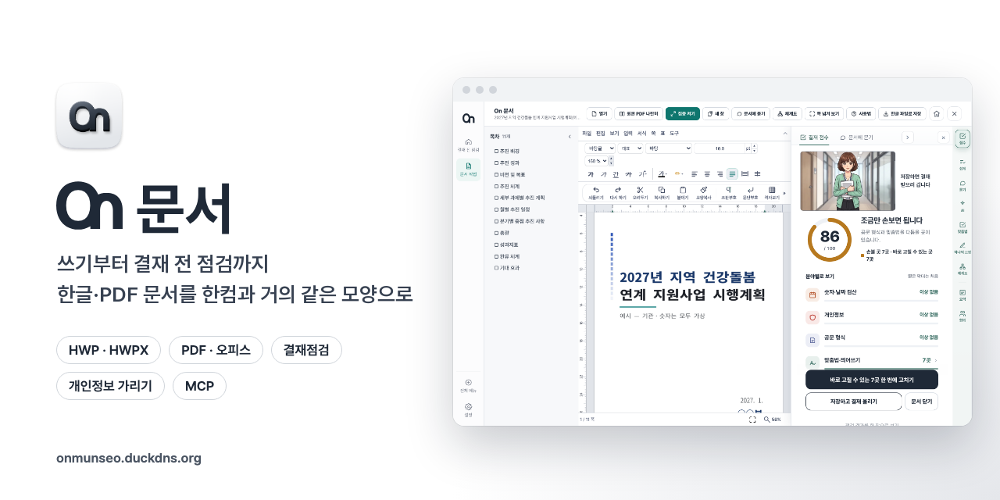
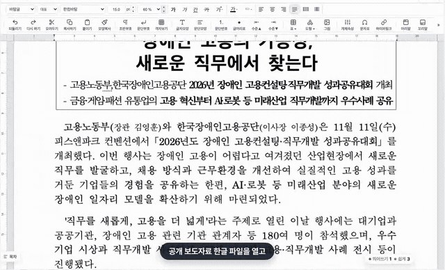
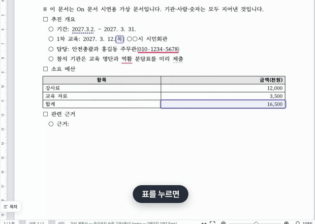
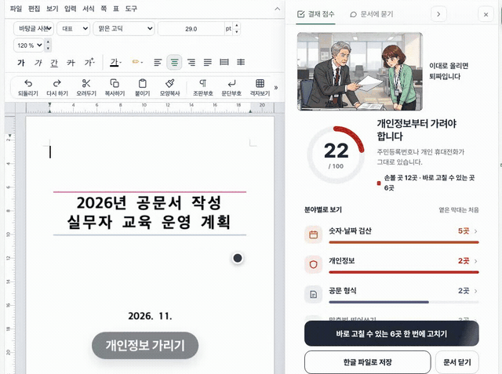
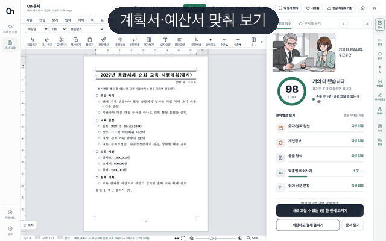
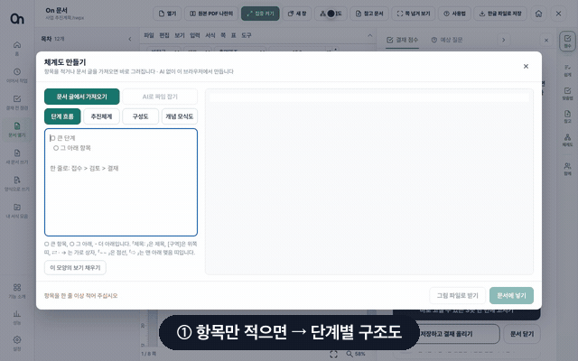
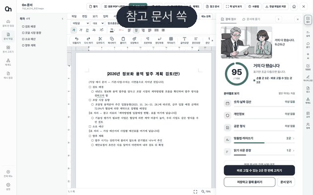
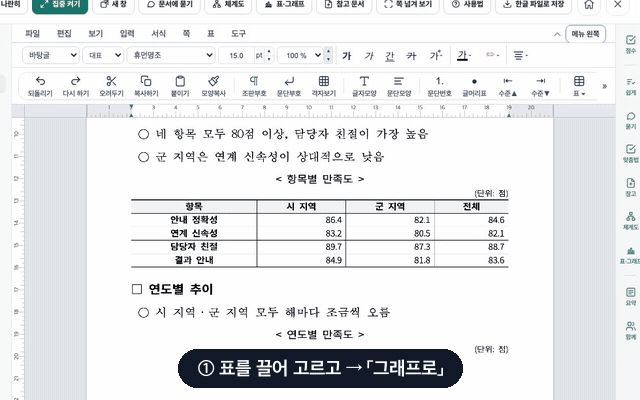
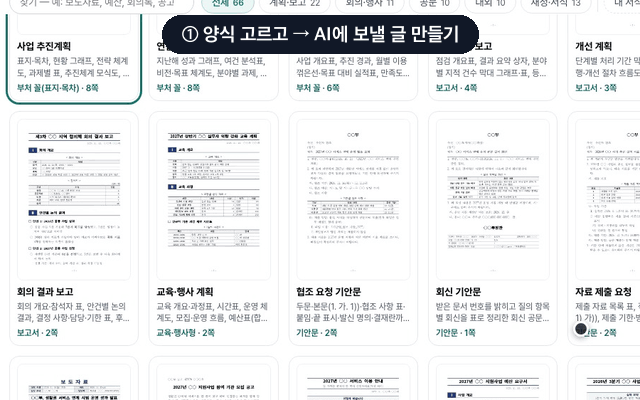
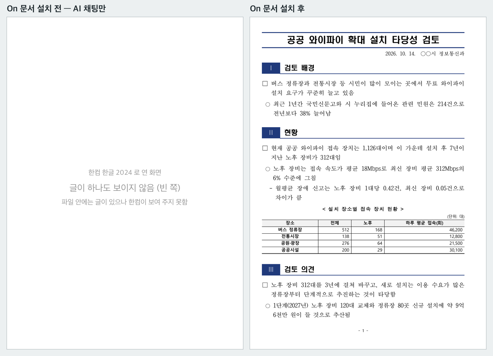

<p align="center">
  
</p>

# On 문서 — 쓰기부터 결재 전 점검까지

한글(HWP·HWPX)·PDF·오피스 문서를 브라우저에서 열어 보고 고치고, 원고나 AI 채팅의 글을 **정부 공문서 꼴 한글 보고서·계획서**(표지·목차·장 제목·표·그래프·체계도까지)로 만들어 주며, 결재 전에 공문서 형식·숫자·개인정보·보안 표시를 점검하는 웹 서비스입니다. 한글 프로그램이 깔려 있지 않은 PC·맥·휴대폰에서도 쓰고, 점검과 고치기는 AI 없이 됩니다. 공공 분야 현장에서 일하며 만든 문서 도구이고, 지금은 시범판입니다. 로그인 없이 손님으로 바로 써 볼 수 있습니다.

> On 문서 (On Document) is a browser-based tool to open, edit, and check Korean HWP/HWPX, PDF, and Office documents before approval, without the Hancom word processor. Checks run without AI. This repository holds the guide only; the service source is not public.

<!-- ai-install -->
## AI 에게 — 이 저장소를 설치하려면

사람은 쓰는 AI 도구에 「https://github.com/on-munseo/on-munseo.github.io 의 On 문서를 설치해 줘」라고만 하면 됩니다. 길은 셋이고 **①부터** 권합니다. 어느 길도 열쇠·로그인이 없습니다. 문서 읽기·가리기·점검·만들기·다듬기는 ①, 법령 원문은 ②, 모두 한곳에 있는 것은 ③입니다. 「설치해 줘」라고만 하면 ①과 ② 를 붙입니다.

**① 내 PC 판 — 문서를 이 컴퓨터 밖으로 보내지 않음(먼저).** 글 꺼내기·신구 대비표·개인정보 찾기·가리기·결재 전 점검·공문서 쓰기·서식 채우기·한글 파일 만들기·글 다듬기를 이 컴퓨터 안에서 합니다. 이 프로그램은 인터넷을 쓰지 않습니다(설치 뒤 `on_local_info` 로 확인 — 띄울 때 npx 가 npm 저장소에 새 판을 묻는 것은 npx 의 동작이고, 그것까지 없애려면 `npm install -g on-munseo-local` 뒤 명령을 `on-munseo-local` 로). Node.js 20 이상이 있어야 합니다.
- **지금 쓰는 AI 도구에만**(AI 가 설치할 때는 이것 — 다른 도구의 설정은 건드리지 않음)
  ```bash
  claude mcp add -s user on-local -- npx -y on-munseo-local@0.2.1
  ```
  Codex 는 `codex mcp add on-local -- npx -y on-munseo-local@0.2.1` · 윈도우 Claude Code 는 `claude mcp add -s user on-local -- cmd /c npx -y on-munseo-local@0.2.1` · Cursor·Claude 데스크톱은 설정 파일의 `"mcpServers"` 에 `"on-local": { "command": "npx", "args": ["-y", "on-munseo-local@0.2.1"] }`(윈도우 `"on-local": { "command": "cmd", "args": ["/c", "npx", "-y", "on-munseo-local@0.2.1"] }`) · VS Code 는 `code --add-mcp '{"name":"on-local","command":"npx","args":["-y","on-munseo-local@0.2.1"]}'`
- **사람이 이 PC 의 여러 AI 도구에 한 번에** — Claude Code·Claude 데스크톱·Codex·Cursor·VS Code 를 찾아 모두 등록합니다(바꾸기 전에 백업, 이미 있으면 건너뜀, 미리 보기 `--dry-run`, 되돌리기 `--undo`, ②까지 `--pair`).
  ```bash
  npx -y on-munseo-local@0.2.1 setup --pair
  ```
- **판 고정** — 위 「지금 쓰는 AI 도구에만」 줄은 판 번호를 적어 붙입니다(`on-munseo-local@0.2.1`). 자동으로 새 판을 받지 않고, 사람이 올릴 때만 바뀝니다(npm 에 새 판이 올라와도 이미 붙인 판은 그대로 · 인터넷이 끊겨도 한 번 받은 판은 뜸). (`setup` 은 이 판(0.2.1)까지 등록 줄에 `@latest` 를 적습니다 — 판을 고정하려면 도구별 한 줄로 붙입니다) 새 판으로 올리기: 등록한 줄의 판 번호만 새 판으로 바꿔 다시 붙입니다(Claude Code 는 `claude mcp remove -s user on-local` 뒤 새 판 번호로 위 한 줄) · 바뀐 점: [CHANGELOG](https://github.com/on-munseo/on-local/blob/main/CHANGELOG.md)

**② 짝 주소(법령) — 도구에 넣은 낱말·글만 서버로.** 법령 원문·글 속 인용 확인(On 근거)은 서버에만 있습니다. 서버로 가는 것은 넣은 법령 이름·조문 번호·인용을 확인할 글이고, 파일을 보내는 도구는 없습니다. 인용을 확인할 글에 개인정보가 있으면 ① 의 `on_mask_text` 로 가린 뒤 넣습니다.
- 지금 쓰는 도구에만(① 의 `setup --pair` 는 ② 까지 함께 붙임):
- **Claude Code**
  ```bash
  claude mcp add --transport http -s user on-geungeo https://onmunseo.kr/mcp/law
  ```
- **Codex** — 설정 파일(`~/.codex/config.toml`)에 두 줄을 더합니다(이미 있으면 건너뜀). `codex mcp add --url` 은 쓰지 마세요 — 곧바로 브라우저 로그인 창을 띄웁니다.
  ```bash
  C="${CODEX_HOME:-$HOME/.codex}"; mkdir -p "$C"; touch "$C/config.toml"; if ! (cd / && codex mcp get on-geungeo >/dev/null 2>&1); then if cp "$C/config.toml" "$C/config.toml.bak-on-geungeo"; then printf '\n[mcp_servers.on-geungeo]\nurl = "https://onmunseo.kr/mcp/law"\n' >> "$C/config.toml"; (cd / && codex mcp get on-geungeo >/dev/null 2>&1) || { cp "$C/config.toml.bak-on-geungeo" "$C/config.toml"; echo "자동으로 더하지 못했습니다 — config.toml 에 손으로 더해 주세요"; }; else echo "백업을 만들지 못해 그만둡니다 — config.toml 은 그대로입니다"; fi; fi; (cd / && codex mcp get on-geungeo)
  ```
  윈도우이거나 명령 줄 `codex` 가 없는 곳(IDE 확장만)은 그 파일 끝에 `[mcp_servers.on-geungeo]`·`url = "https://onmunseo.kr/mcp/law"` 두 줄을 손으로 더합니다(파일에 `mcp_servers = { … }` 한 줄 표가 이미 있으면 그 안에 `on-geungeo = { url = "https://onmunseo.kr/mcp/law" }` 를 더함).
- **Cursor** `"on-geungeo": { "url": "https://onmunseo.kr/mcp/law" }` · **VS Code** `code --add-mcp '{"name":"on-geungeo","type":"http","url":"https://onmunseo.kr/mcp/law"}'` · **Claude 데스크톱·claude.ai**(사람이 화면에서) 설정 → 커넥터 → 맞춤 커넥터 추가 → 이름 `On 근거`, 주소 `https://onmunseo.kr/mcp/law` → 「연결」

**③ 서버 판 — Node.js 없이 바로, 도구 전부(공개 문서용).** 문서를 서버(국내 데이터센터)로 보내 메모리에서만 처리하고 버립니다. 공개 문서·본인 문서에만 씁니다.
- **Claude Code**
  ```bash
  claude mcp add --transport http -s user on-document https://onmunseo.kr/mcp
  ```
- **Codex** — 설정 파일(`~/.codex/config.toml`)에 두 줄을 더합니다(이미 있으면 건너뜀). `codex mcp add --url` 은 쓰지 마세요 — 곧바로 브라우저 로그인 창을 띄웁니다.
  ```bash
  C="${CODEX_HOME:-$HOME/.codex}"; mkdir -p "$C"; touch "$C/config.toml"; if ! (cd / && codex mcp get on-document >/dev/null 2>&1); then if cp "$C/config.toml" "$C/config.toml.bak-on-document"; then printf '\n[mcp_servers.on-document]\nurl = "https://onmunseo.kr/mcp"\n' >> "$C/config.toml"; (cd / && codex mcp get on-document >/dev/null 2>&1) || { cp "$C/config.toml.bak-on-document" "$C/config.toml"; echo "자동으로 더하지 못했습니다 — config.toml 에 손으로 더해 주세요"; }; else echo "백업을 만들지 못해 그만둡니다 — config.toml 은 그대로입니다"; fi; fi; (cd / && codex mcp get on-document)
  ```
  윈도우이거나 명령 줄 `codex` 가 없는 곳(IDE 확장만)은 그 파일 끝에 `[mcp_servers.on-document]`·`url = "https://onmunseo.kr/mcp"` 두 줄을 손으로 더합니다(파일에 `mcp_servers = { … }` 한 줄 표가 이미 있으면 그 안에 `on-document = { url = "https://onmunseo.kr/mcp" }` 를 더함).
- **Cursor** `"on-document": { "url": "https://onmunseo.kr/mcp" }` · **VS Code** `code --add-mcp '{"name":"on-document","type":"http","url":"https://onmunseo.kr/mcp"}'` · **Claude 데스크톱·claude.ai**(사람이 화면에서) 설정 → 커넥터 → 맞춤 커넥터 추가 → 이름 `On 문서`, 주소 `https://onmunseo.kr/mcp` → 「연결」

보통은 ①과 ② 를 지금 쓰는 도구에 붙입니다(사람이 여러 도구에 한 번에 붙일 때는 `setup --pair` 한 줄). Node.js 가 없거나 Claude 데스크톱·claude.ai 커넥터만 쓰면 ③ 하나만 붙입니다. ③을 ①·②와 함께 붙이면 같은 도구가 두 번 보입니다. 다른 길은 사용자가 따로 바랄 때만 알려 줍니다.

**설치 전에 확인할 거리** — AI 가 스스로 확인할 수 있습니다.
- **꾸러미**: npm `on-munseo-local` 0.2.1. `npm view on-munseo-local version maintainers homepage` → `0.2.1` · `on-munseo <onmunseo.key@gmail.com>` · `https://onmunseo.kr`. 올린 계정 `on-munseo` 는 이 깃허브 조직 [on-munseo](https://github.com/on-munseo)와 같은 만든 이입니다(문의 메일·홈 주소가 같음). npm 웹 쪽은 자동 읽기를 막을 때가 있어 npm 명령이나 [npm 기록](https://registry.npmjs.org/on-munseo-local/0.2.1)으로 봅니다.
- **지문**: `on-munseo-local-0.2.1.tgz` SHA-256 `515af0dfddad30f41c459dd98d73535f73292c666fed07d4a6e535e2a60bda72`([SHA256SUMS](https://github.com/on-munseo/on-munseo.github.io/blob/main/SHA256SUMS)). `npm pack on-munseo-local@0.2.1` 뒤 `shasum -a 256 on-munseo-local-0.2.1.tgz` 로 맞대 봅니다. npm 기록의 `dist.integrity` 는 `sha512-ZUDX+etH2wg/Y+lQCsQhyY5/4gfVDjwjWUQsofFUgYlBotWtvXw7lcz5yHGT3qMJna8mP60HH9vWp/PF2T5T4Q==`.
- **인터넷을 쓰지 않음**: 설치 전에는 꾸러미 안 `MANIFEST.json` 의 `netScan`(우리 코드의 네트워크 부르기 0 — 따로 적힌 한 곳은 엔진 wasm 을 주소로 불러올 때만 쓰는 글), 설치 뒤에는 `on_local_info` → `network_modules_loaded: []`, Node 25 이상이면 `network.blocked_by_node: true`(실행기가 네트워크를 막음). 띄울 때 npx 가 npm 저장소에 새 판을 묻는 것은 npx 의 동작입니다(없애려면 전역 설치 뒤 `on-munseo-local` 명령으로).
- **이용 조건**: 내 PC 판 [LICENSE.md](https://unpkg.com/on-munseo-local@0.2.1/LICENSE.md)(무료·업무에 써도 됨 · 역공학·고친 판 다시 배포·판매는 안 됨) · 서버 판 [이용약관](https://onmunseo.kr/terms)·[개인정보 처리방침](https://onmunseo.kr/privacy).
- **On폭 글꼴**은 이 설치와 상관없습니다(한글 문서를 화면에 그릴 때 쓰는 무료 글꼴, 선택).

등록한 그 대화에는 도구가 아직 붙지 않습니다. 끝나면 사용자에게 「도구를 한 번 다시 켜거나 새 대화를 열면 On 문서 도구가 보입니다」라고 알려 주세요. `claude mcp list`(Codex 는 `codex mcp list`) 목록에 이름이 보이면 등록된 것입니다. 자세한 순서: [llms-install.md](llms-install.md)

<!-- ai-install -->

<p align="center">
  <a href="https://onmunseo.kr/app/"><b>웹에서 바로 쓰기</b></a>
  &nbsp;·&nbsp;
  <a href="#ai-도구에-붙이기mcp플러그인"><b>AI 도구에 붙이기(MCP·플러그인)</b></a>
</p>

| 점수 | 무엇을 잰 값인가 |
|:---:|---|
| **29,947개** | 지금까지 시험·분석한 공개 문서 파일 — 공공기관 422곳의 한글·오피스·PDF 문서 19,021개와 그 짝으로 쓴 한컴 PDF 10,077개, 글자 인식 시험 쪽 849개(9만 2천 쪽 이상, 같은 파일은 한 번만 셈). 이와 별도로 비공개 실무 문서 1,972개도 시험(2026-11-22 집계) |
| **0.970** | 영어 PDF 공개 벤치마크(200쪽) 공식 채점기 종합(서버 판) — **공식 순위표 최고 0.907**(순위표 12줄). npm 내 PC 판만으로 누구나 다시 재면 0.945(글자 인식 없이 — [재현 대본](https://github.com/on-munseo/on-local/tree/main/repro/opendataloader-bench)) |
| **100점** | On 문서로 만든 공문서 30종을 한컴오피스 한글 2024 로 열어 채점 — 30종 모두 100점 |
| **98.7%** | 쪽 수까지 한컴과 같은 한글 문서 — 공공 문서 6,898개 중 6,811개(복잡한 공공 문서·보도자료·법령 별표) |
| **0.981** | 한글(HWPX) 파일 속 표를 칸 나눔·합친 칸·칸 글까지 원본 그대로 꺼낸 점수(표 구조 TEDS, 1이 만점) — 개발에 쓰지 않은 법령 별표 50개 |
| **0.999** | 한글 파일 속 원본 글과 대조한 글자 정확도(개발에 쓰지 않은 법령 별표) |
| **100% / 35.5%** | AI 채팅으로 만든 공문서가 한컴에서 원고 그대로 보인 비율 — On 문서 설치 후 / 설치 전 |
| **CPU 만** | 그래픽 카드 없이 CPU 2코어·메모리 2.5GB 서버에서 돎. 문서는 처리한 뒤 남기지 않음 |

<sub>모두 직접 잰 값입니다(2026-11-26 기준). 공식 순위표 값은 순위표가 밝힌 값이고, 우리 값은 같은 공식 채점기로 우리가 잰 값입니다. 누구나 다시 잴 수 있게 대본을 공개한 것은 [믿을 근거](#믿을-근거--남이-다시-확인할-수-있는-것)에 있습니다. 잰 판과 날짜는 [직접 잰 숫자](#직접-잰-숫자)에 있습니다.</sub>

<p align="center">
  <br>
  가상 계획서를 열면 틀린 곳이 짚히고, 「한 번에 고치기」를 누르면 그 자리에서 고쳐집니다. 요일·합계처럼 사람이 봐야 할 곳은 남겨 둡니다.
</p>

## 다른 도구와 견줄 때

같은 문서·같은 채점으로 직접 잰 값입니다. 공식 순위가 아니며, 잰 판·조건·정의는 [측정 자료](docs/benchmark.md)에 있습니다.

| 견줄 갈래 | On 문서 | 견준 상대 | 잰 날 |
|---|---|---|---|
| 한글 읽기 — 공공 한글 1,726개 한글 글자 재현율(한컴 PDF 대조) | 99.87% | 국내 공개 엔진 A 99.87%(같음) | 2026-11-12 |
| 한글 읽기 — 법령 별표 HWPX 50개 원본 대조 글자 오류율 · 표 구조 TEDS | 0.09% · 0.981 | A 0.12% · 0.968 | 2026-11-20 · 11-23 |
| 오피스 읽기 — 공공데이터 457개 표 칸 재현율(워드·엑셀·파워포인트) | 98.95 · 99.80 · 99.89% | A 90.08 · 99.01 · 95.63% | 2026-11-17 · 11-23 |
| 영어 PDF 200쪽 공식 채점기 — 기본 읽기(그림 속 글 가볍게) · 정밀 읽기 | 0.971 · 0.970 | A 최신 기본 0.965 · 0.967 | 2026-11-26 · 11-25 |
| 글 꺼내기 속도 — 공식 한글 2,150개(같은 M3 맥북·같은 실행, 데운 뒤) 합계 · 문서당 가운데 | 3.1초 · 0.27ms | A 36.8초 · 0.52ms | 2026-11-26 |
| 쪽 그림 — 복잡한 공공 문서 1,470개 중 쪽 수까지 한컴과 같은 문서 · 제목 크기 글이 사라진 문서 | 1,454 · 1 | 바탕 엔진 rhwp 원판 v0.9.0 1,410 · 55 | 2026-11-22~23 |
| 공문서 만들기 — 한컴오피스 한글 2024 로 연 자체 30과제 평균 점수 | 99.6(지금 시범판 100) | 공개 HWPX 보고서 생성 MCP 86.4 | 2026-11-19(지금 판 11-25) |

- 진 곳도 적습니다: 영어 PDF 의 표(TEDS) 칸은 국내 공개 엔진 A 최신 판(0.9805)이 우리 기본 읽기(0.9799)보다 조금 높습니다(2026-11-26). 법제처 API 를 실시간으로 부르는 법령 조회 MCP 는 자치법규·행정규칙 본문·의료 밖 판례까지 더 넓게 찾고, On 근거는 미리 받은 사본으로 의료·응급 법률 55개의 위임·개정 이유·벌칙·판례·해석례를 잇는 깊이와 글 속 법령 인용 확인이 몫입니다.
- On 한글엔진은 공개 엔진 rhwp(MIT) 바탕에 우리 고침을 더한 것입니다. 점검·가리기·만들기는 언어 모델(AI) 없이 규칙으로 해서 같은 입력이면 같은 결과이고, 표·그래프·체계도는 원문 숫자를 하나라도 잃으면 결과 대신 까닭을 냅니다.
- AI 도구 연결(MCP)로 보낸 문서는 서버(국내 데이터센터)의 메모리에서만 처리하고 버립니다. 서버를 거치는 MCP 에는 공개 문서·본인 문서만 — 기관 내부 문서는 웹 편집기에서 브라우저 안에서 처리하는 기능(한글 열기·고치기·저장, 결재 전 점검, 개인정보 가리기)으로 다룹니다(웹 편집기라도 첨부 글 꺼내기·글자 인식·한글 파일 만들기는 서버를 거침).

**바로 가기:** [다른 도구와 견줄 때](#다른-도구와-견줄-때) · [믿을 근거](#믿을-근거--남이-다시-확인할-수-있는-것) · [이럴 때 쓰세요](#이럴-때-쓰세요) · [할 수 있는 일](#할-수-있는-일) · [누가 어떻게](#누가-어떻게) · [직접 잰 숫자](#직접-잰-숫자) · [한계](#한계) · [이용 조건](#이용-조건) · [열쇠 신청·문의](#문의)

## 믿을 근거 — 남이 다시 확인할 수 있는 것

**하는 일(일의 낱말로).** ① 내 PC 판 하나로 — 읽기(한글·PDF·워드·엑셀·파워포인트의 글·표) · 신구 대비표(두 판 견주기) · 결재 전 점검(공문서 형식·맞춤법·날짜·요일·금액) · 개인정보 찾기·가리기(가린 글·가린 한글 파일) · 공문서 쓰기(보고서·계획서·결과보고서·보도자료) · 예시 양식 66종 채우기 · 서식 채우기 · 글을 표로 · HWP→HWPX 바꾸기 · 글 다듬기(개조식·맞춤법·쉬운 말). 법령 원문·글 속 인용 확인은 ② 짝 주소, 그래프·체계도 그림·PDF·글자 인식은 ③ 서버 판에 있습니다. 내 PC 판의 도구 이름은 설치 뒤 `on_local_info` 의 `tools_here` 에 모두 나옵니다.

**누구나 다시 잴 수 있는 숫자.** 아래 셋은 공개한 대본·공개 출처·npm 꾸러미만으로 돌아갑니다(비공개 코드 없음). 우리가 잰 값이지만, 남이 같은 값을 다시 낼 수 있습니다.

| 무엇 | 값 | 다시 재는 법 |
|---|---|---|
| 영어 PDF 200쪽 — [opendataloader-bench](https://github.com/opendataloader-project/opendataloader-bench) 공식 채점기(고치지 않음) 종합 | **0.945**(읽는 순서 0.949 · 표 0.938 · 제목 0.938) — 공식 순위표 최고 0.907 | [repro/opendataloader-bench](https://github.com/on-munseo/on-local/tree/main/repro/opendataloader-bench) — npm `on-munseo-local@0.2.1`(0.2.1 도 바이트까지 같은 결과). 결과 200개 지문이 다섯 번 모두 같음 |
| 서식 채우기 — 법제처 공개 법령 서식·별지 709개 | 값을 넣은 654개 가운데 **653개가 원래 서식 그대로**(글꼴·문단·표 모양과 그림은 바이트 그대로, 본문 짜임 같음, 빠진 글자 0). 남은 1개는 한 줄에 날짜 칸과 쌍점 칸이 겹친 서식의 결함(고칠 것) | [repro/form-fill](https://github.com/on-munseo/on-local/tree/main/repro/form-fill) — 같은 꾸러미 · 서식 709개의 원 출처 주소·SHA-1 목록. 두 번 돌려 만든 파일 지문이 모두 같음 |
| 개인정보 찾기 — 공개 시험 [korean-pii-benchmark-v3](https://huggingface.co/datasets/schift-io/korean-pii-benchmark-v3) 473줄(정답은 그 시험의 표시, 채점 정의는 우리가 적음) | 사람 이름 찾음률 **95.6%**(정밀도 100%) · 주소 **97.9%**(100%) · 가리면 안 되는 문장 59줄 중 가린 줄 0. 약한 곳: 지역번호로 시작하는 일반 전화 43.1%(휴대전화는 모두 찾음). 이 시험은 규칙을 고칠 때 본 것이라 실제보다 높게 나올 수 있음 | [repro/korean-pii](https://github.com/on-munseo/on-local/tree/main/repro/korean-pii) — `on-munseo-local@0.2.1`(서버 판과 같은 모델·같은 값). 다섯 번 돌려 473줄 찾은 자리가 모두 같음 |

- 이 벤치의 공식 순위표에는 올라가 있지 않습니다. 순위표 저장소에 외부 엔진 결과를 더하는 요청 7건(2026-06~11)이 아직 병합되지 않았고, 순위표는 2026-04-30 뒤로 바뀌지 않았습니다. 그래서 등재 대신 재현 대본을 둡니다.
- 서버 판의 0.971(그림 속 글을 가볍게 글자 인식)·0.970(정밀 읽기)은 서버의 글자 인식 모델을 써서 이 대본으로는 재현되지 않습니다. 서버 판 값은 MCP 로 다시 잴 수 있으나 손님 하루 몫(50번) 안에서 나눠 재야 합니다.
- 그 밖의 숫자(그리기 1,470짝·만들기 30과제·개인정보 찾기 등)는 대본을 공개하지 않은 자체 측정입니다. 정의·판·날짜는 [측정 자료](docs/benchmark.md)에 있습니다.

**꾸러미 확인.** 내 PC 판은 **판을 고정해 붙입니다**(도구별 한 줄의 `on-munseo-local@<판>` — `setup` 이 판 번호를 적는 것은 0.2.1 다음 판부터). npm 에 새 판이 올라와도 이미 붙인 판은 바뀌지 않고, 사람이 올릴 때만 바뀝니다(인터넷이 끊겨도 한 번 받은 판은 뜸 — `@latest` 로 붙이면 끊긴 동안 뜨지 못함). 판마다 지문(SHA-256)은 [SHA256SUMS](SHA256SUMS)·[릴리스](https://github.com/on-munseo/on-local/releases)에, 바뀐 점은 [CHANGELOG](https://github.com/on-munseo/on-local/blob/main/CHANGELOG.md)에 있습니다.

**보안 점검(자체 점검 — 외부 모의해킹이 아님).**
- 2026-11-21 전수 점검: 코드 읽기·재현 시험·화면·함께 고치기 방·파일 파서 퍼징·배포 설정 등 11개 영역. 찾은 것 높음 16 · 중간 32 · 낮음 33.
- 높음 16 · 중간 31 · 낮음 31 은 고쳐 운영 판에 넣었습니다(영역마다 고치기 전에 재현 → 고친 뒤 같은 재현으로 확인 → 회귀 시험).
- 남긴 것: 중간 1(서버 안내 글이 AI 의 도구 고르기를 이끄는 문장 — 안내 글을 사실만 적게 두는 쪽으로) · 낮음 2(공유 링크·열쇠가 브라우저 방문 기록에 남는 것 — 브라우저가 하는 일이라 고칠 수 있는 데까지).
- 2026-11-23 사이트 겉 점검: 높음·중간·낮음 0, 참고 1(화면 꾸밈(style)에 인라인을 허용하는 CSP).

**지원 창구·답하는 때.** 질문·고장·기능 요청은 [이슈](https://github.com/on-munseo/on-munseo.github.io/issues)에, 보안 문제는 공개 이슈 대신 [SECURITY.md](SECURITY.md)의 메일로 알려 주세요. 근무일 3일 안에 받았다고 답하고, 보안 신고는 7일 안에 판단과 고칠 일정을 알립니다.

## 이럴 때 쓰세요

- **맥·한글 없는 PC에서 한글 파일을 고쳐 저장할 때** — 보기만이 아니라 글과 표를 고치고 한글(HWPX) 파일로 저장합니다. 설치 없이 브라우저에서 됩니다.
- **휴대폰에서 받은 hwp를 그 자리에서 고쳐 보낼 때** — 한컴과 같은 쪽 나눔·줄바꿈으로 열어 글을 고치고, 한글(HWPX) 파일로 저장해 보낼 수 있습니다.
- **결재 올리기 전에** — 날짜·요일, 금액·표 합계, 공문 표기, 맞춤법, 개인정보를 규칙으로 찾아 결재 점수로 보여 주고, 답이 정해진 곳은 한 번에 고칩니다.
- **대외비·보안 등급 문서를 AI에 올리기 전에** — 여는 순간 글로 적힌 보안 표시를 찾아 잠그고, 잠긴 동안은 AI·서버로 아무것도 보내지 않습니다. 그림으로만 찍힌 표시는 놓칠 수 있습니다.
- **개인정보가 든 문서를 보내기 전에** — 주민등록번호·전화번호·계좌번호 같은 개인정보를 찾아 문서에서 바로 가립니다. 이 브라우저 안에서 되고 서버로 보내지 않습니다.
- **AI 열쇠가 없는데 초안이 필요할 때** — 「도우미에게 맡기기」로 자료를 올리면 서버 도우미가 자료를 규칙으로 정리해 표지·목차가 있는 공문서 초안(한글 파일)을 몇 초 안에 만들어 줍니다. AI 를 쓰지 않아 원문에 없는 말을 지어내지 않고, 자료는 서버 밖으로 나가지 않습니다.
- **고른 문장을 공문서 말투로 바꾸거나 제목이 필요할 때** — 「바꿔 쓰기 도우미」(서버 안에서 도는 KT Mi:dm 2.0 Mini)가 공문서 문장·제목 후보 3개를 제안합니다(요약은 속도를 맞춘 뒤 켤 예정). 원래 글과 나란히 보여 주고, 원문에 없는 숫자는 빨갛게 짚습니다.
- **AI 채팅에 자료를 넘길 때** — 「자료 올리기」로 파일을 올리면 15분 동안만 열리는 자료 주소가 나옵니다. 그 주소를 AI 채팅에 주면 AI 가 On 문서로 글과 표를 꺼내 읽습니다.
- **AI 채팅은 쓰는데 결과를 한글 양식으로 받기 어려울 때** — 챗GPT·클로드·제미나이 같은 AI 채팅(무료·구독)에 붙여 넣을 글을 만들어 주고, 받은 답을 고른 양식의 한글 문서로 만듭니다. AI 열쇠 없이 됩니다.
- **문서를 서버에 남기지 않는 도구가 필요할 때** — 점검·가리기·체계도는 브라우저 안에서 되고, 서버를 거치는 일(한글로 바꾸기·글 꺼내기·글자 읽기·도우미)도 메모리에서만 다루고 처리 뒤 바로 버립니다.
- **PDF를 한글 파일로 옮길 때** — 글과 표를 꺼내 한글 파일로 만듭니다. 본문·제목 글꼴과 크기는 살리지만 쪽 모양이 그대로 옮겨지지는 않습니다.
- **영수증·스캔 문서의 글자를 옮길 때** — 사진이나 스캔 PDF의 글자를 읽어 고칠 수 있는 한글 문서로 엽니다. 손글씨는 틀리기 쉬워 원본과 맞춰 보셔야 합니다.

## 할 수 있는 일

### AI 없이

- **결재 전 점검·한 번에 고치기** — 열자마자 점수와 고칠 곳이 보이고, 날짜 표기·개인 휴대전화·맞춤법 같은 곳은 눌러서 한 번에 고칩니다.
- **숫자 검산** — 합계·요일·날짜가 맞지 않으면 짚어 줍니다. 표는 누르기만 하면 합계를 다시 계산합니다.
- **대외비 잠금** — 대외비 등 보안 표시가 있으면 여는 순간 잠그고, 서버·AI로 아무것도 보내지 않습니다.
- **개인정보 가리기** — 주민등록번호·전화·계좌 등을 찾아 문서에서 바로 가립니다.
- **연관 문서 대조** — 계획서와 예산서처럼 두 문서의 금액·날짜가 어긋난 곳을 찾습니다.
- **체계도·골라 바로** — 항목만 적거나 이미 쓴 글을 고르면 칸 모식도·흐름도·추진체계도가 그려집니다. 상자 글은 원문 낱말을 줄여 쓰고 새 말을 만들지 않습니다. 글을 고르면 형광펜·각주도 바로 답니다.
- **표를 그래프로·차트 고치기** — 표를 고르면 그 숫자로 그래프를 바로 그려 넣습니다. 문서 안 차트는 두 번 눌러 값을 고치면 그림과 한글 파일에 함께 들어갑니다.
- **개조식·쉬운 말·맞춤법** — 서술형 문단을 □ ○ - 개조식으로, 번역투·어려운 한자어를 쉬운 말로 바꾸고, 맞춤법·띄어쓰기를 봅니다.
- **AI 채팅으로 쓰고 한글로 받기** — 양식에 맞춰 AI 채팅에 붙여 넣을 글을 만들고, 받은 답을 붙여 넣으면 그 양식의 한글 문서로 만듭니다. 「물론입니다!」 같은 인사말은 지우되 지운 줄은 늘 보여 주고 되살릴 수 있습니다. AI 에는 사용자가 직접 붙여 넣으며, 이 서비스가 AI 로 보내는 것은 없습니다.
- **법률 자동 완성** — 법률 이름과 조만 치면 조문 제목까지 넣어 줍니다. 서버에 담아 둔 법제처 공개 법령 자료로 찾습니다.
- **정식 한글처럼 열기** — 한글(HWP·HWPX)·PDF·워드·PPT·엑셀을 브라우저에서 열고 한글 파일로 저장합니다. 원본 PDF를 옆에 띄워 견줘 볼 수도 있습니다.
- **양식으로 쓰기** — 계획·보고·행사·공고·보도자료 등 예시 양식 66종에서 골라 씁니다.
- **도우미에게 맡기기** — 첨부한 자료를 규칙으로 정리해 표지·목차가 있는 공문서 초안(한글 파일)을 몇 초 안에 만듭니다. 원문 문장을 골라 쓰므로 자료에 없는 말을 지어내지 않습니다.
- **바꿔 쓰기 도우미(열쇠 없이)** — 고른 글을 공문서 문장으로 다듬고, 제목 후보 3개를 제안합니다. 결과는 늘 「제안」으로 원래 글과 나란히 보여 주고, 원문에 없는 숫자는 빨갛게 짚습니다. *서버 안의 작은 AI(KT Mi:dm 2.0 Mini)가 하며, 글은 서버 밖으로 나가지 않습니다.*

### 내 AI 열쇠를 연결하면

본인 AI 열쇠(Claude 또는 Gemini)를 연결하면 위 기능에 더해 아래를 씁니다. 열쇠는 이 브라우저에만 두고 우리 서버로 보내지 않습니다. 글은 브라우저에서 고른 AI 회사로 바로 갑니다.

- **쓰기** — 적어 둔 원고를 보고서·계획서·보도자료·기안문 꼴로 정리, 넣은 자료 파일만 근거로 초안 쓰기, 받은 공문 → 회신 기안문.
- **고치기·다듬기** — 말로 요청하면 해당 문단을 고치고 고친 곳마다 되돌리기, 「AI로 더 쉽게」, 핵심 구절만 굵게.
- **점검·예상 질문** — 맞춤법·띄어쓰기 의견을 문단마다 받고 고르기, 결재권자·감사관·민원인이 물을 만한 곳을 근거와 함께 찾기.
- **묻기·요약·풀이** — 문서 안 내용으로만 답하고 근거 문단을 함께 보여 주기, 메신저·메일·보고용 정리, 낱말·표·그림 풀이.

보안 표시(대외비 등)가 있는 문서는 AI 로 보내지 않도록 잠깁니다. 글을 보내기 전에 주민등록번호·전화번호·메일 주소는 가립니다.

### AI 도구에 붙이면 — 법령 원문까지(On 근거)

AI 채팅이나 Claude Code 에 On 문서를 붙이면([AI 도구에 붙이기](#ai-도구에-붙이기mcp플러그인)) 문서 도구와 함께 법령 원문 도구도 씁니다. 열쇠 없이 손님으로도 됩니다.

- **조문 원문** — 현행 법령(법률·시행령·시행규칙 등 5,600여 개)의 조문 원문과 조문 목록을 그대로 꺼내고, 법령 안에서 문구를 찾습니다. 약칭(감염병예방법·개인정보보호법 등)으로 불러도 됩니다.
- **글 속 법령 인용 확인** — 공문·보고서 초안에 적은 「법령」 제N조제K항제M호를 현행 원문과 맞대어, 없는 법령·없는 조·삭제된 조·없는 항·호와 조문 제목이 다른 곳을 짚습니다. AI 없이 규칙으로 합니다.
- **의료·응급 법령 깊이 보기** — 의료·응급·보건·감염병·소방 등 법률 55개(시행령·시행규칙·별도 규칙·고시 포함)는 위임 조문, 곧 시행될 개정, 개정 이유와 신구 대비, 의무와 벌칙·과태료, 별표, 법마다 다른 용어 정의까지 보고, 미리 받아 둔 의료 분야 판례 3,527건·법령해석례 1,045건에서 찾습니다.
- 법제처 현행 원문을 미리 받아 둔 사본(지금 것은 2026-11-23 받음)에서 그대로 꺼내고, 결과 끝에 받은 날을 적습니다. 결과는 참고용이며 최종 판단은 법령 원문과 담당 기관 해석으로 합니다.

### 기능 모습

<table>
<tr>
<td width="50%" valign="top"><br><b>정식 한글처럼 열기</b><br>한글 파일과 같은 파일을 한컴 한글에서 PDF로 저장한 것을 나란히 띄우면, 줄바꿈까지 같은 자리인 것을 바로 견줘 볼 수 있습니다.</td>
<td width="50%" valign="top"><br><b>표 한눈에</b><br>표를 누르면 합계·최대·최소를 AI 없이 바로 계산해, 틀린 합계를 짚어 줍니다.</td>
</tr>
<tr>
<td width="50%" valign="top"><br><b>대외비는 AI로 안 나가요</b><br>「대외비」 표시가 있는 가상 문서를 열면 바로 잠기고, AI 단추를 눌러도 보내지 않습니다. 점검·고치기는 그대로 됩니다.</td>
<td width="50%" valign="top"><br><b>개인정보는 눌러서 가리기</b><br>주민등록번호·휴대전화를 찾아 문서에서 바로 가립니다(예시 번호는 지어낸 것).</td>
</tr>
<tr>
<td width="50%" valign="top"><br><b>계획서·예산서 맞춰 보기</b><br>예산서를 넣으면 날짜·인원·금액이 어긋난 곳을 두 문서에서 함께 짚고, 맞는 쪽 값으로 바로 바꿉니다.</td>
<td width="50%" valign="top"><br><b>체계도·모식도 쉽게</b><br>항목만 적거나 이미 쓴 글을 골라 「모식도로」를 누르면 칸 모식도·흐름도·추진체계도가 그려지고, 그대로 문서에 들어갑니다.</td>
</tr>
<tr>
<td width="50%" valign="top"><br><b>참고 문서 쏙</b><br>참고 PDF·엑셀을 옆 창에 놓으면 표를 칸 그대로 꺼내 빈 표 자리에 넣습니다. 출처는 각주로 붙습니다.</td>
<td width="50%" valign="top"><br><b>표를 그래프로·차트 고치기</b><br>표를 고르면 그 숫자로 그래프를 그려 넣습니다. 문서 안 한글 차트는 두 번 눌러 값을 고치면 바뀝니다.</td>
</tr>
<tr>
<td colspan="2" valign="top"><br><b>AI 채팅으로 쓰고 한글로 받기</b> — AI 채팅에 붙여 넣을 글을 만들고, 받은 답을 붙여 넣으면 양식 꼴의 한글 문서로 만듭니다. 인사말은 지우고 지운 줄은 보여 줍니다. AI 열쇠 없이 됩니다.</td>
</tr>
</table>

화면 예시의 계획서·예산서·보안 문서는 모두 지어낸 것입니다(기관·사람·숫자는 「○○」 꼴). 「정식 한글처럼 열기」의 보도자료(고용노동부, 2026. 11. 11.)와 「참고 문서 쏙」의 조달청 보도자료(2025. 11. 20.)는 각 기관 누리집에 공개된 것으로, 내용을 바꾸지 않고 보여 줍니다.

## 누가 어떻게

### 처음이면 — 웹 편집기에서 바로

[onmunseo.kr/app/](https://onmunseo.kr/app/) 을 엽니다. 설치는 필요 없습니다.

- **로그인 없이(손님):** 열쇠 없이 바로 씁니다. 한글 열기·고치기·점검·저장은 이 브라우저 안에서 하고 서버로 보내지 않습니다. 손님이 고친 문서와 최근 파일은 창을 닫으면 지워지고, 「이 기기에 기억하기」를 켤 때만 이 기기에 남습니다.
- **손님 하루 몫:** 서버를 거치는 일(첨부 글 꺼내기·한글 파일 만들기·AI 도구 연결)은 한 주소에서 하루 50번·1분에 6번(AI 도구의 법령 도구는 따로 하루 100번·1분에 20번), 파일 하나 6MB까지입니다. 바꿔 쓰기 도우미는 하루 20번, 도우미에게 맡기기는 하루 3번입니다. 손님 전체의 하루 몫이 차면 한국 시간 자정까지 닫힙니다.
- **열쇠가 있어야 하는 것:** 사진·스캔 글자 인식, PDF 정밀 읽기(그림 속 글·표까지), 워드·PPT·PDF 를 한글로 바꿔 고치기, 함께 고치기, AI 도구 연결의 나머지 도구 5개(한글로 바꾸기·PDF·쪽 그림 둘·도장), 더 큰 파일과 넉넉한 하루 몫. 열쇠 신청: `onmunseo.key [at] gmail.com`(제목에 「On 문서 열쇠 신청」)
- **열쇠·초대 링크로:** 받은 초대 링크를 열거나 열쇠를 넣고 들어갑니다.
- 순서를 따라 하고 싶으면 [시작하기](https://onmunseo.kr/start) 쪽을 봐 주세요. 「AI 채팅으로 쓰기」와 「자료 올리기」도 여기서 시작합니다.

### AI 도구에 붙이기(MCP·플러그인)

AI 채팅이나 Claude Code 를 자주 쓰면 On 문서를 도구로 붙여, 대화 안에서 문서를 읽고 한글 파일까지 받습니다.

- **채팅 AI(챗GPT·클로드):** 커넥터 설정에 주소 하나 `https://onmunseo.kr/mcp` 를 붙입니다. 열쇠가 있으면 연결할 때 뜨는 On 문서 로그인 창에 열쇠를 넣습니다. 열쇠 없이 붙이면 손님 도구 38개가 보입니다 — 문서 도구 22개(글 꺼내기·결재점검·개인정보 찾기와 가린 글·가린 한글 파일·한글 파일 만들기·공문서 쓰기·글 다듬기)와 법령 원문 도구(On 근거) 16개입니다.
- **Claude Code:** 한 줄이면 됩니다. 등록한 뒤 Claude Code 를 다시 켜면(`/exit` 뒤 `claude`, VS Code 는 새 대화) 도구가 보입니다. 열쇠가 있으면 `/mcp` 에서 `on-document` 를 골라 로그인하고, 없으면 그대로 손님 도구로 씁니다.
  ```bash
  claude mcp add --transport http -s user on-document https://onmunseo.kr/mcp
  ```
- **Codex:** 설정 파일 `~/.codex/config.toml` 에 두 줄 `[mcp_servers.on-document]`·`url = "https://onmunseo.kr/mcp"` 를 더하면 로그인 창 없이 손님으로 씁니다(`codex mcp add --url` 은 곧바로 On 문서 로그인 창을 띄움). 열쇠가 있으면 두 줄을 넣은 뒤 로그인합니다: `codex mcp login on-document`
- 한글 보고서·계획서·결과보고서·보도자료를 만드는 도구는 공문서 쓰기(`on_write_gov`)이고, `on_write` 는 꾸밈 없는 일반 한글 문서를 만듭니다.
- 법령 조문을 쓰거나 점검할 때는 On 근거(`law_article`·`med_article`·`law_check_citations` 등)가 법제처 원문으로 확인합니다. `/mcp` 에 함께 들어 있고, 법령 도구만 따로 붙이는 주소는 `/mcp/law` 입니다.
- 열쇠가 있으면 PDF 를 읽을 때 `precise: true` 로 정밀 읽기(그림 속 글·표까지 제자리에)를 고를 수 있습니다. 손님은 기본 읽기로 읽습니다.
- 주소는 `/mcp` 하나를 권장합니다. 도구마다 순서는 [INSTALL.md](INSTALL.md), 고급용 묶음 주소(`/mcp/text`·`/mcp/check`·`/mcp/mask`·`/mcp/hwpx`·`/mcp/gov`·`/mcp/tidy`·`/mcp/write`·`/mcp/law`)·도구 목록·한도·플러그인·Cursor·Claude 데스크톱 설정은 [MCP.md](MCP.md)에 있습니다.
- 열쇠를 주소 뒤에 붙이지 마세요. 대화 기록과 접속 기록에 남습니다.

<p align="center">
  <br>
  Claude Code 에 글 꺼내기 묶음을 붙여 예시 계획서(가상 자료)를 읽은 실제 서버 응답입니다.
</p>

### 제품별 저장소

기능 하나만 AI 도구에 붙이려면 제품별 저장소를 봅니다. 저장소마다 연결 한 줄·도구 표·손님 한도와, 잰 것이 있는 곳은 직접 잰 성능이 있고, Claude Code 플러그인(`claude plugin install <저장소 이름> --marketplace on-munseo/<저장소 이름>`)으로도 붙습니다. 제품 저장소의 플러그인은 ① 내 PC 판을 붙이고, 결재점검·공문서 쓰기·근거는 ② 법령 짝도 함께 붙입니다(Node.js 20 이상). 웹 화면은 이 저장소의 On 문서 하나이고, 처음이면 위의 `/mcp` 하나를 권장합니다.

| 제품 | 하는 일 | 저장소 | 주소(앞에 `https://onmunseo.kr`) |
|---|---|---|---|
| On 글꺼내기 | 한글·PDF·오피스에서 글과 표 꺼내기 | [on-munseo/on-text](https://github.com/on-munseo/on-text) | `/mcp/text` |
| On 결재점검 | 공문서 형식·맞춤법·날짜·요일·금액·목록 합계 점검 | [on-munseo/on-check](https://github.com/on-munseo/on-check) | `/mcp/check` |
| On 개인정보 가리기 | 개인정보 찾기·가린 글·가린 한글 파일 | [on-munseo/on-mask](https://github.com/on-munseo/on-mask) | `/mcp/mask` |
| On HWPX 만들기 | 마크다운으로 한글(HWPX) 파일 만들기·서식 채우기·쪽 그림 | [on-munseo/on-hwpx](https://github.com/on-munseo/on-hwpx) | `/mcp/hwpx` |
| On 공문서 쓰기 | 공문서 꼴 한글 보고서·계획서·보도자료, 표·그래프·체계도 | [on-munseo/on-gov](https://github.com/on-munseo/on-gov) | `/mcp/gov` |
| On 글 다듬기 | 개조식·맞춤법·띄어쓰기·쉬운 말 | [on-munseo/on-tidy](https://github.com/on-munseo/on-tidy) | `/mcp/tidy` |
| On 근거 | 법령 조문 원문·글 속 법령 인용 확인 | [on-munseo/on-geungeo](https://github.com/on-munseo/on-geungeo) | `/mcp/law` |
| On폭 글꼴 | 한글 문서에 자주 쓰는 글꼴과 글자 폭을 맞춘 무료 글꼴(SIL OFL 1.1) — MCP 설치와 상관없음(선택) | [napurrin/onpok-fonts](https://github.com/napurrin/onpok-fonts) | — |

## 문서는 어떻게 다루나

- **저장하지 않습니다.** 서버를 거치는 일(한글로 바꾸기·글 꺼내기·글자 읽기·도우미)은 서버 메모리 안에서만 다루고, 처리가 끝나면 버립니다. 기록에는 글 내용을 남기지 않습니다.
- 「자료 올리기」로 올린 파일과 결과 받기 주소는 15분 뒤 사라집니다.
- 결재 전 점검·개인정보 가리기·체계도는 브라우저 안에서 합니다.
- 보안 등급 표시(대외비 등)가 글로 적힌 문서는 처리하지 않고 돌려보냅니다.
- **AI 채팅에 붙여 넣은 글과 AI 가 읽은 자료는 그 AI 회사로 갑니다.** 서버를 거치는 일(AI 도구 연결·자료 올리기·첨부 글 꺼내기·글자 인식·한글 파일 만들기)에는 공개 문서와 본인 문서만 넣어 주세요. 기관 내부 문서는 웹 편집기에서 브라우저 안에서 처리하는 기능(한글 열기·고치기·저장, 결재 전 점검, 개인정보 가리기)으로 다루세요([이용 조건](#이용-조건)).
- 참고 자료: 국가정보원 [「국가·공공기관 AI보안 가이드북」](https://www.nis.go.kr/AF/1_7_7_1.do)(2025년 12월)
- 자세한 것은 [이용약관](https://onmunseo.kr/terms)과 [개인정보 처리방침](https://onmunseo.kr/privacy)에 있습니다.

## 직접 잰 숫자

공공 문서를 한컴 한글이 만든 결과와 맞대어 직접 잰 값입니다. 공식 순위가 아닙니다.

| | |
|---|---|
| **1만 9천여 개** | 시험한 공개 공공 문서(짝 PDF 까지 파일 2만 9천여 개, 겹침 뺌). 그 가운데 공개 문서 6,821개·55,180쪽은 열고 저장하고 다시 열어 **멈춤 0 · 저장 실패 0** |
| **99.87%** | 법령 별표·보도자료 한글 1,726개에서 꺼낸 한글 글자(한컴 PDF 의 1,716,582자 기준) |
| **100개 중 98~99개** | 쪽 수까지 한컴과 같은 문서 — 복잡한 공공 문서 1,454/1,470 · 정책브리핑 보도자료 1,982/1,996 · 법령 별표 3,375/3,432 |
| **30종 모두 100점** | On 문서로 만든 공문서 30종을 한컴오피스 한글 2024 로 열어 채점 — 끝 줄에 1~2글자만 넘어간 문단 0 |
| **0.971** | 영어 PDF 200쪽 공개 벤치마크 공식 채점기 종합(기본 읽기 — 그림 속 글을 가볍게 읽음, 2026-11-26) — 공식 순위표 최고 0.907(순위표 12줄). 그림 속 글까지 다 읽는 정밀 읽기는 0.970(그림 속 글 규칙을 만들 때 보지 않은 125쪽만 재도 0.970 — 바탕 읽기 규칙은 이 벤치를 보며 다듬었음). 글자 인식이 없는 npm 내 PC 판은 0.945 이고 누구나 다시 잴 수 있습니다([재현 대본](https://github.com/on-munseo/on-local/tree/main/repro/opendataloader-bench)) |
| **0.999 · 0.981** | 한글(HWPX) 파일 속 원본 글과 대조한 글자 정확도 · 표 구조 점수(TEDS) — 개발에 쓰지 않은 법령 별표 50개 |
| **1.000 · 0.989~0.999** | 워드·엑셀·파워포인트 공공데이터 457개 글 재현율 · 표 칸 재현율(워드 0.989 · 엑셀 0.998 · 파워포인트 0.999) |
| **95.6% · 94.5%** | 서버를 거치는 개인정보 찾기(AI 도구 연결)의 사람 이름 찾음률 — 공개 시험 473건 · 모델 학습에 쓰지 않은 날짜의 관보 3,138조각. 관보에서 이름이라고 찾은 것 가운데 맞은 것은 90.7% |
| **1초에 약 190쪽** | 한글 그리기(복잡한 공공 문서 43,942쪽 평균, 윈도우 i7-14700). 글 꺼내기는 공식 한글 2,150개를 모두 3.1초(M3 맥북, 데운 뒤). 서버는 그래픽 카드 없이 CPU 2코어·메모리 2.5GB |

<sub>한글 그리기(쪽 수·사라진 글)는 2026-11-22 에 고친 측정기로 잰 값입니다. 복잡한 공공 문서·정책브리핑은 그때 시범판에서 돌던 On 한글엔진 2.2.1(2026-11-23, 지금 시범판은 2.2.3), 법령 별표는 2.1.9(2026-11-22)로 쟀습니다. 만들기 30과제는 2.2.1 과 그때 시범판의 공문서 쓰기(2026-11-25), 6,821개 열기·저장은 2.1.6, 그리기 속도는 2.1.4(모두 2026-11-19), 한글 글 꺼내기는 2026-11-12 판, 한글 원본 대조는 2026-11-20(글자)·2026-11-23(표), 오피스는 2026-11-23, 영어 PDF 는 2026-11-25, 개인정보는 2026-11-25 에 쟀습니다. 만들기 30과제·오피스·영어 PDF·개인정보는 그때 시범판에 들어간 판(같은 코드)으로 잰 값입니다. 문서 수는 2026-11-22 집계. 남은 약점은 [한계](#한계)에 같은 무게로 적었습니다. 정의·95% 신뢰구간·직접 재 보는 법은 [측정 자료](docs/benchmark.md)에 있습니다. 문서별 결과 목록은 공개하지 않습니다(연구·검증 목적이면 `onmunseo.key [at] gmail.com` 으로 요청해 주세요). 「한컴과 같다」는 한컴 프로그램이 만든 PDF 와 견준 결과일 뿐, 인증이나 제휴가 아닙니다.</sub>

<p align="center">
  
</p>

<sub>출처: 농촌진흥청 보도자료 「'생리장해 줄이고 생산성 높이고' 인삼 예정지 토양 관리 중요」(2026. 4. 30.) 3쪽, [정책브리핑](https://www.korea.kr/briefing/pressReleaseView.do?newsId=156759536), 공공누리 제1유형. 왼쪽 한컴 PDF(만든 프로그램 한글 2024) · 오른쪽 On 문서.</sub>

### 같은 한글 파일, 왜 다르게 보일까요?

- **글꼴:** 한컴 글꼴이 없는 PC·맥·휴대폰은 다른 글꼴로 대신 그려서 줄이 밀리고 쪽 수가 바뀝니다.
- **보기 프로그램:** 프로그램마다 글상자·표·쪽 나눔을 다르게 그립니다.
- **한컴도 판마다:** 한컴 프로그램도 판에 따라 조금씩 다르게 그립니다.

On 문서는 한글이 파일에 저장해 둔 줄 자리를 그대로 쓰고, 다시 나눠야 할 때는 한컴 PDF 와 견주며 맞춘 규칙으로 나누며, 한컴 글꼴과 글자 폭을 맞춘 [온폭 글꼴](https://github.com/napurrin/onpok-fonts)(무료, SIL OFL 1.1)을 함께 씁니다.

### On 문서 설치 전·후, 무엇이 달라지나

같은 원고 5편(가상의 ○○ 자료)으로 한글(HWPX) 공문서를 두 가지 방법으로 만들고, 한컴오피스 한글 2024 로 열어 PDF 로 저장한 결과를 같은 잣대로 쟀습니다. 설치 전은 AI 채팅만으로 AI 가 스스로 코드를 짜서 만든 파일, 설치 후는 On 문서(공문서 쓰기)로 만든 파일입니다. 같은 잣대를 30과제 채점 방식으로 점수로 매기면 **설치 전 57.1점, 설치 후 100점**입니다.

| 한컴 한글 2024 로 연 결과 | On 문서 설치 전 — AI 채팅만 | On 문서 설치 후 |
|---|---|---|
| 열린 문서 | 5/5 | 5/5 |
| 열렸지만 글이 하나도 보이지 않은 문서 | 3/5 | 0/5 |
| 원고 내용이 그대로 보인 요소(제목·문단·표 칸) | 60/169 (35.5%) | 169/169 (100%) |
| 둘째 줄이 첫 줄 글자 자리에서 시작한 □·○·- 문단 | 0/17 | 28/28 |
| 쪽 끝에 제목만 남은 곳 | 0 | 0 |
| 끝 줄에 1~2글자만 넘어간 문단 | 1/17 | 0/28 |
| (참고) 끝 줄이 줄 폭의 1/3 도 안 되는 문단 | 6/17 | 15/28 |
| 쪽 수(보고서·검토 보고·계획서·결과보고서·보도자료) | 1·1·3·1·2 (1쪽 셋은 빈 쪽) | 1·2·4·3·1 |

설치 전의 문단 숫자는 글이 보인 2편만 센 값입니다. 끝 줄이 짧은 문단은 설치 후가 더 많습니다.

<p align="center">
  
</p>
<p align="center">
  
</p>

<sub>어떻게 쟀나 — 여기서 「설치」는 AI 채팅에 On 문서 MCP 를 연결한 것입니다. ① 두 쪽 모두 같은 원고와 같은 요청 「이 자료로 공문서 꼴 한글(HWPX) 보고서를 만들어 줘」(보고서 자리는 과제 종류)로 만들었습니다. 설치 전은 MCP·플러그인 없이 빈 폴더에서 범용 AI 코딩 도구가 과제마다 한 번 만든 그대로이고(고르거나 다시 시키지 않음), 설치 후는 같은 원고에서 AI 가 뽑아 고정해 둔 짜임으로 On 문서 공문서 쓰기를 부른 결과입니다. ② 두 쪽 파일을 한컴오피스 한글 2024(9.1.1)로 열어 PDF 로 저장하고 그 PDF 를 쟀습니다. 「글이 보이지 않음」은 한컴에서 연 문서의 본문 글자가 0자라는 뜻입니다. ③ 설치 후 파일은 2026-11-26 에 그때 시범판에 들어간 판(On 한글엔진 2.2.1)으로 다시 만들었고, 설치 전 파일은 2026-11-22 에 만든 것을 그대로 썼습니다(다시 만들면 AI 답이 달라져 같은 조건이 되지 않음). 두 쪽 파일 모두 2026-11-26 에 한글 2024 로 다시 열어 쟀습니다. 자세한 값은 [측정 자료](docs/benchmark.md#on-문서-설치-전후--같은-원고-5편)에 있습니다. 5편은 작은 표본이고, AI 와 때에 따라 설치 전 결과는 달라질 수 있습니다. 사람이 한컴에서 열어 보고 다시 시키면 나아질 수 있습니다.</sub>

## 한계

- **사라지는 글이 아직 있습니다.** 복잡한 공공 문서 1,470개 가운데 130개(8.8%)는 글 일부가, 1개(0.07%)는 제목 크기 글이 한컴과 달리 보이지 않습니다. 정책브리핑 1,996개에서는 30개·0개, 법령 별표 3,432개에서는 34개·1개입니다(법령 별표는 2.1.9 로 잰 값). 중요한 문서는 원본과 맞춰 봐 주세요.
- **쪽 수가 다른 문서:** 1,470개 가운데 16개, 정책브리핑 1,996개 가운데 14개, 법령 별표 3,432개 가운데 57개는 한컴과 쪽 수가 다릅니다. 한글 2024 로 만든 PDF 와는 같은 줄 비율이 전체보다 낮습니다(95.97%·97.67%).
- **끝 줄이 짧게 남는 문단:** 공문서 쓰기로 만든 30과제에서 두 줄 이상으로 넘어간 □·○·- 문단 153개 가운데 89개는 끝 줄이 3글자를 넘지만 줄 폭의 1/3 이 안 됩니다(끝 줄에 1~2글자만 남은 문단은 0). 글은 그대로 두고 빈칸을 먼저 줄여 115개에서 줄인 값이고, 더 줄이려면 문장을 고쳐야 합니다.
- **보안 표시:** 글로 적힌 표시(대외비·비밀 등급 등)만 찾습니다. 그림으로만 찍힌 표시는 놓칠 수 있습니다.
- **사진·스캔 문서:** 큰 AI 모델·GPU 없이 서버 CPU 로 읽어 큰 AI 모델보다 낮습니다. 처음 보는 스캔 표 칸 시험 통과 88.8%, 한국어 글자 인식 공개 시험(877쪽) 종합 0.883, 그 가운데 손글씨 0.850 입니다. 손글씨는 특히 틀리기 쉽습니다.
- **개인정보 중 사람 이름:** AI 도구 연결처럼 서버를 거치는 개인정보 찾기·가리기는 규칙에 우리가 학습한 작은 모델을 더해 찾습니다(아래는 2026-11-26 에 올린 모델 2판 값). 공개 시험 473건에서 이름 찾음률 95.6%(같은 코드에서 모델 없이 규칙만 쓰면 58.4%)이지만, 이 시험은 놓친 꼴을 보고 규칙을 고칠 때 본 것이라 실제보다 높게 나올 수 있습니다. 모델 학습에 쓰지 않은 날짜의 관보 3,138조각에서는 이름 찾음률 94.5%, 이름이라고 찾은 것 가운데 맞은 것 90.7% 이고, 가릴 것이 없는 조각 733개 가운데 53개를 잘못 가렸습니다(규칙만 쓰면 19개). 웹 화면에서 바로 가리는 기능은 브라우저 안 규칙으로만 찾고 이 모델을 쓰지 않습니다. 어느 쪽이든 가린 결과를 한 번 더 확인해 주세요.
- **PDF·오피스 → 한글 바꾸기:** 글과 표를 옮깁니다. 그림과 글꼴 모양은 일부만 옮기고, 쪽 모양은 그대로 옮기지 않습니다.
- **영어 PDF:** 위 0.971 은 손님·AI 도구 연결의 기본 읽기 값입니다 — 한글이 아닌 쪽의 그림 자리 몇 곳만 가볍게 글자 인식해 제자리에 넣습니다(문서당 약 0.1초, 맥북 M5 Pro, 하루 글자 인식 한도에 세지 않음). 정밀 읽기(0.970, 문서당 0.40초 — 아이맥 M1)는 열쇠로 쓸 때 PDF 에서만 고를 수 있고(웹 「읽기」 화면·AI 도구 연결의 `precise: true`), 하루 글자 인식 한도 안에서 셉니다.
- **법령 원문(On 근거):** 법제처 현행 원문을 미리 받아 둔 사본이라(지금 것은 2026-11-23 받음) 그 뒤의 개정은 다음 사본 때 들어갑니다. 받은 날은 결과 끝에 적힙니다. 고시·훈령 같은 행정규칙은 이름만 찾고, 본문은 의료·응급 법률에 딸린 것만 있습니다. 판례·해석례는 미리 받아 둔 의료 분야 것에서만 찾습니다. 짧은 시간에 아주 많이 부르거나 한 법의 조문을 차례로 훑으면 법령 도구가 하루 동안 멈춥니다.
- **서버 도우미:** 「도우미에게 맡기기」는 원문 문장을 골라 정리하므로 큰 AI 채팅보다 덜 매끄럽고, 긴 글에서는 핵심이 조금 빠질 수 있습니다. 「바꿔 쓰기 도우미」(Mi:dm)는 작은 모델이라 제안을 늘 확인해야 하고, 한 번에 6~10초 걸립니다.
- **접속:** 인터넷으로만 씁니다. 업무망(폐쇄망)에서는 쓸 수 없습니다. 옛 주소(onmunseo.duckdns.org)도 당분간 함께 열려 있습니다.
- **시범판:** 열쇠마다, 손님마다 하루 몫과 동시에 처리하는 수가 정해져 있습니다. 손님이 몰려 자리가 차면 몇 초 기다리거나 「잠시 뒤 다시」 안내가 나옵니다.
- **점검 결과는 참고용입니다.** AI 가 쓴 글과 점검 결과는 결재 전에 사람이 확인해 주세요.

## 이용 조건

- **시범판과 MCP 는 무료 시범 서비스입니다.** 기능·하루 몫·주소는 바뀌거나 멈출 수 있습니다.
- 프로그램으로 대량 호출하거나 결과를 자동으로 모아 가지 마세요.
- On 문서가 만든 결과물과 응답을 AI 모델 학습 자료로 쓰지 마세요.
- 사이트에서 내려받는 엔진·프로그램 파일을 떼어 따로 쓰거나 다시 배포하지 마세요.
- **서버를 거치는 일에는 공개 문서와 본인 문서만 넣어 주세요.** 기관 내부 문서는 웹 편집기에서 브라우저 안에서 처리하는 기능(한글 열기·고치기·저장, 결재 전 점검, 개인정보 가리기)으로 다루세요.
- 글과 그림은 CC BY 4.0, 설정 파일은 MIT 입니다. 「On 문서」 이름과 로고는 이 허락에 들어가지 않습니다([저작권·라이선스](#저작권라이선스)). 그 밖은 [이용약관](https://onmunseo.kr/terms)을 따릅니다.

## 문의

- 열쇠 신청: `onmunseo.key [at] gmail.com`(제목에 「On 문서 열쇠 신청」). 쓰려는 곳(개인·업무·연구 등)과 필요한 기능을 적어 주세요.
- 질문·고장 신고·기능 요청은 [이슈](https://github.com/on-munseo/on-munseo.github.io/issues)에 남겨 주세요. 문서 파일이나 개인정보는 이슈에 올리지 마세요(이슈는 누구나 봅니다).
- 숫자와 안내가 바뀌면 이 저장소의 [커밋 기록](https://github.com/on-munseo/on-munseo.github.io/commits/main)에 남깁니다. 다시 찾아보실 때를 위해 저장소 위쪽의 ★(Star)로 표시해 두셔도 됩니다.

## 고지

「한글」·「한컴」·「HWP」·「HWPX」는 주식회사 한글과컴퓨터의 상표(등록상표 포함)입니다. On 문서는 한글과컴퓨터와 제휴·후원·승인 관계가 없는 독립 서비스입니다. 본 제품은 한글과컴퓨터의 한글 문서 파일(.hwp) 공개 문서를 참고하여 개발하였습니다. HWPX 는 한국산업표준 KS X 6101(OWPML)을 따르는 문서 형식입니다.

"Hangul", "Hancom", "HWP", and "HWPX" are trademarks or registered trademarks of Hancom Inc. On 문서 is an independent service with no affiliation, sponsorship, or endorsement by Hancom Inc.

챗GPT·클로드·Claude·제미나이·Gemini·Cursor·KT Mi:dm 등 다른 제품 이름은 각 권리자의 것이며 설명을 위해서만 씁니다. 한글 편집 화면은 공개 엔진 rhwp(MIT)를 바탕으로 고쳐 씁니다. 바꿔 쓰기 도우미는 KT Mi:dm 2.0 Mini(MIT, Copyright (c) 2025 KT Corporation)를 씁니다. 서비스 화면의 만화 그림은 생성 AI(Google Gemini)로 만든 것입니다. On 근거가 돌려주는 법령·판례·법령해석례 원문은 법제처 국가법령정보센터의 공개 자료입니다. 서비스가 쓰는 오픈소스 부품과 글꼴의 라이선스 전문은 서비스 안 「설정 → 오픈소스·라이선스 고지」에 있습니다.

## 저작권·라이선스

- **글과 그림**(README·MCP.md·INSTALL.md·llms-install.md·docs 의 글, 화면 그림, 측정 자료): [CC BY 4.0](https://creativecommons.org/licenses/by/4.0/deed.ko). 출처만 밝히면 복사·배포·고쳐 쓰기·상업적 이용을 할 수 있습니다. 출처 표기 예: 「출처: On 문서(on-munseo)」
- **설정 파일**(`plugin/`·`.claude-plugin/` 안의 plugin.json·.mcp.json·marketplace.json): MIT.
- 「On 문서」 이름과 로고는 위 허락에 들어가지 않습니다.
- 서비스의 엔진·서버 코드와 자료는 이 저장소에 없고 공개하지 않습니다.

전문은 [LICENSE](LICENSE)에 있습니다.
