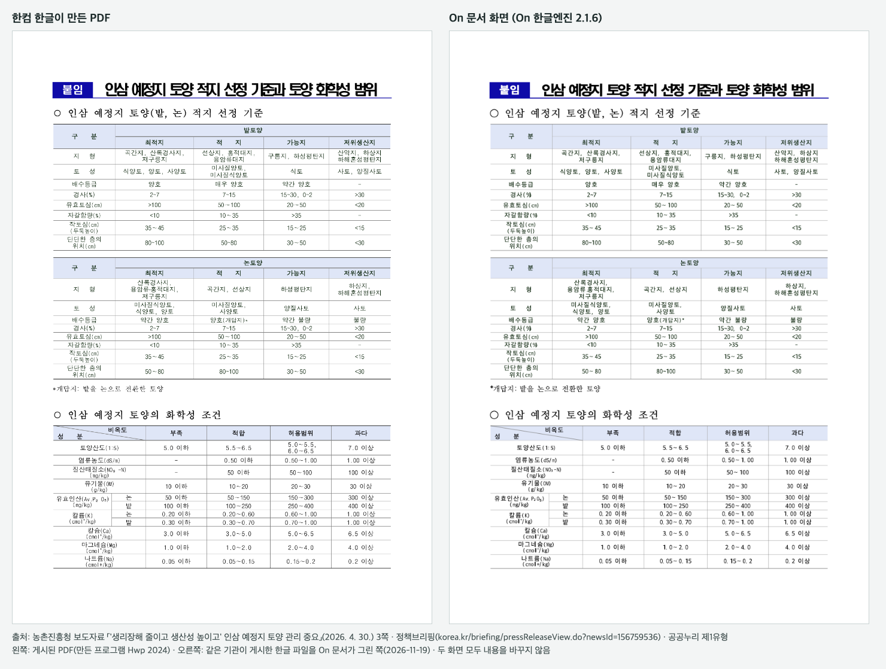
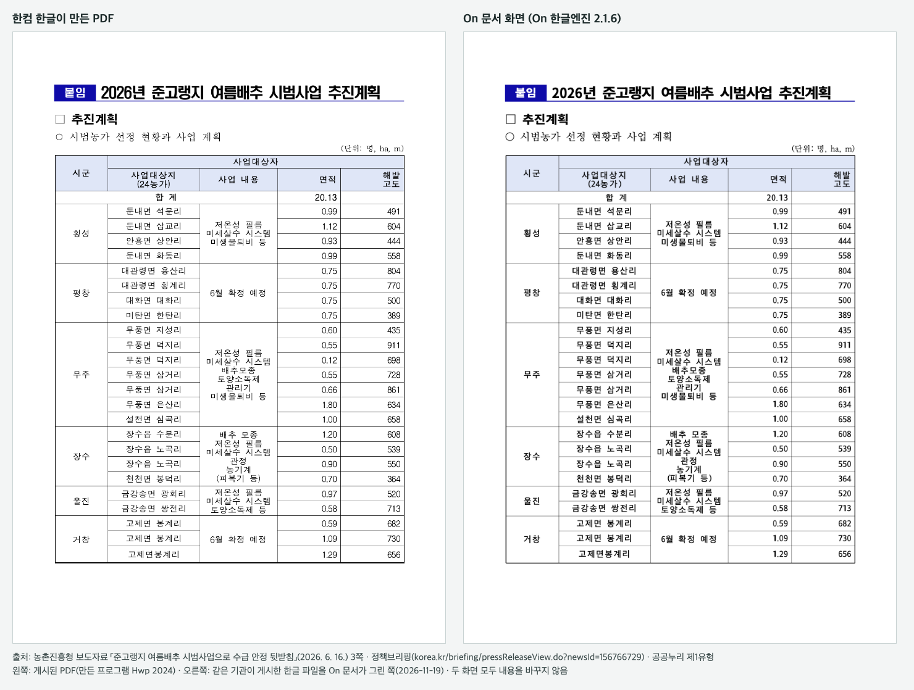
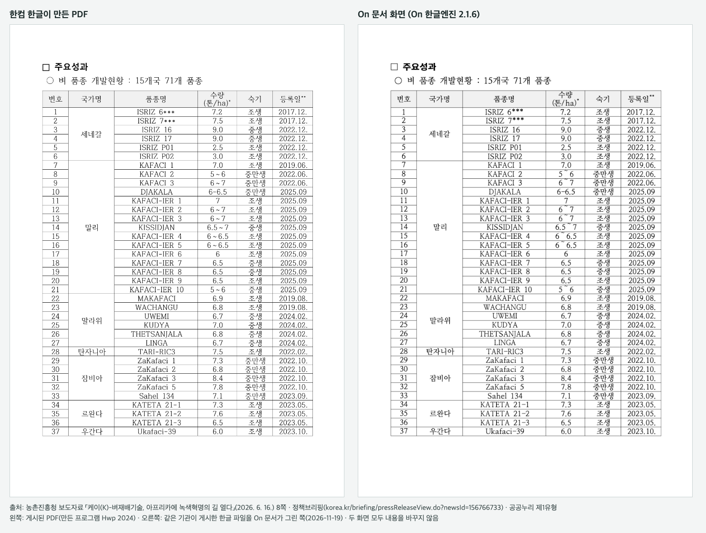
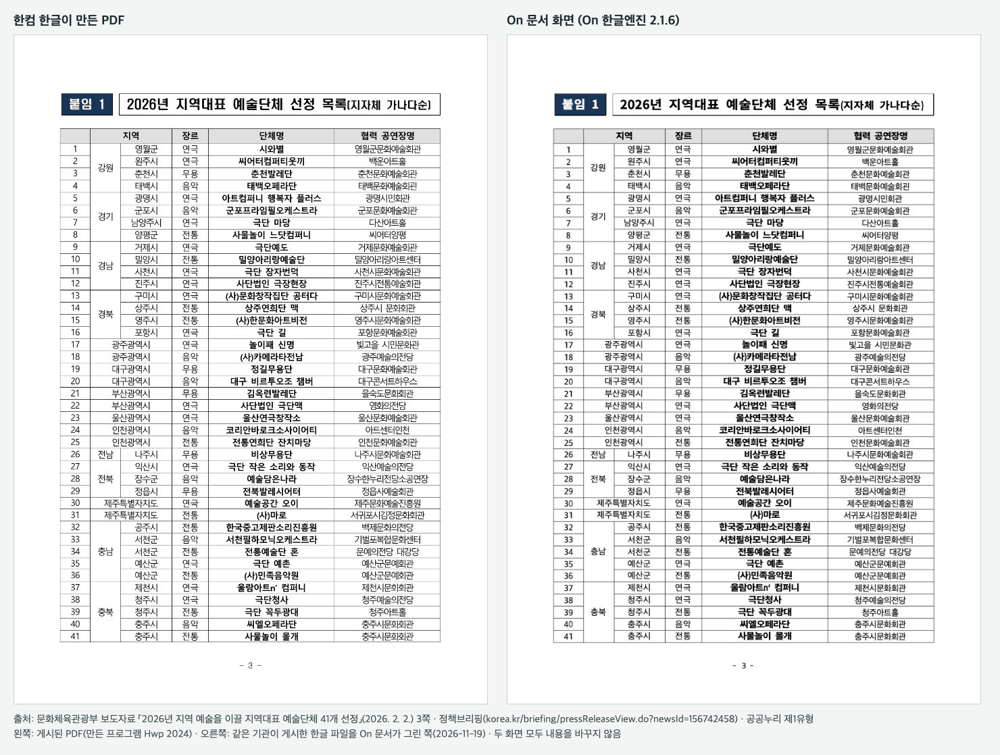

# On 문서 측정 자료

On 문서가 한글 문서를 얼마나 한컴 한글과 같게 그리는지, 문서에서 글과 표를 얼마나 빠짐없이 꺼내는지, 얼마나 빠른지를 직접 잰 기록입니다. 공식 순위가 아닙니다. 측정 코드와 문서별 결과 목록은 공개하지 않고 요약 숫자만 싣습니다. 그 대신 같은 방법을 다른 도구로 다시 짤 수 있게 정의를 자세히 적었습니다. 연구·검증 목적으로 문서별 결과 목록이 필요하면 `onmunseo.key [at] gmail.com` 으로 요청해 주세요.

- 정리한 날: 2026-11-26. 축마다 잰 날짜와 판을 그 축에 적었습니다.
- 우리 엔진 판: On 한글엔진 2.2.1(엔진 지문 `5185ab8720bb`, 잰 때의 시범판 판 — 2026-11-26 부터 시범판은 2.2.3). 법령 별표 3,432짝처럼 다른 판으로 잰 축은 그 판을 따로 적었습니다.
- 그리기 측정기: 2026-11-22 에 고친 판(아래 [2장 측정기 고침](#측정기-고침2026-11-22))으로 다시 쟀습니다. 2026-11-19 판 숫자와 바로 견주지 마세요.
- 글꼴: 모든 그리기 측정은 [온폭 글꼴](https://github.com/napurrin/onpok-fonts)(SIL OFL 1.1)로 그렸습니다. 한컴 글꼴과 상용 글꼴은 쓰지 않았습니다.

## 차례

1. [한눈에 보기](#1-한눈에-보기)
2. [읽는 법 — 기준·용어·통계](#2-읽는-법--기준용어통계)
3. [그리기 — 한글을 한컴과 같은 자리에](#3-그리기--한글을-한컴과-같은-자리에)
4. [만들기 — 한컴 한글 2024 로 연 공문서 30과제](#4-만들기--한컴-한글-2024-로-연-공문서-30과제)
5. [글 꺼내기(파싱) — AI·검색에 넣을 글과 표](#5-글-꺼내기파싱--ai검색에-넣을-글과-표)
6. [안정성 — 공개 문서 6,821개 열기·저장](#6-안정성--공개-문서-6821개-열기저장)
7. [가볍고 빠름](#7-가볍고-빠름)
8. [실패 사례 — 숨기지 않고 적음](#8-실패-사례--숨기지-않고-적음)
9. [시험 문서 규모](#9-시험-문서-규모)
10. [직접 재 보기](#10-직접-재-보기)
11. [문서별 결과 목록](#11-문서별-결과-목록)
12. [나란히 그림](#12-나란히-그림)
13. [한계와 주의](#13-한계와-주의)

## 1. 한눈에 보기

괄호 안은 95% 신뢰구간(Wilson)입니다. 「가운데」는 문서별 값의 중앙값입니다.

| 축 | 문서 | 값 |
|---|---|---|
| 그리기 · 복잡한 공공 문서 | 1,470개(43,685쪽) | 쪽 수가 한컴과 같음 1,454개 = 98.91%(98.24~99.33) · 글이 하나도 빠지지 않음 1,340개 = 91.16%(89.60~92.50) · 제목 크기 글이 사라진 문서 1개 = 0.07%(0.01~0.38) · 같은 줄 비율 가운데 99.91% |
| 그리기 · 정책브리핑 보도자료 | 1,996개(7,480쪽) | 쪽 수 같음 1,982개 = 99.30%(98.83~99.58) · 글 빠짐 없음 1,966개 = 98.50%(97.86~98.95) · 제목 크기 글 사라짐 0개 = 0.00%(0.00~0.19) · 같은 줄 가운데 100% |
| 그리기 · 법령 별표 | 3,432개(5,778쪽) | 쪽 수 같음 3,375개 = 98.34%(97.85~98.72) · 글 빠짐 없음 3,398개 = 99.01%(98.62~99.29) · 제목 크기 글 사라짐 1개 = 0.03%(0.01~0.16) · 같은 줄 평균 99.05%(엔진 2.1.9) |
| 만들기 · 한컴 한글 2024 로 열기 | 공문서 30과제 | 30개 모두 열림(88.65~100) · 공문서 꼴 40점 만점에 30개 모두 40점 · 30개 모두 100점 · 끝 줄 1~2글자 문단 0 · 짧은 끝 줄 47/153(2026-11-26) |
| 글 꺼내기 · 한글(HWP·HWPX) | 1,726개 | 한컴 PDF 한글 글자 재현율 99.87% · 한 글자도 안 빠진 문서 1,705개 = 98.78%(98.15~99.20) |
| 글 꺼내기 · 한글 원본 대조 | 법령 별표 HWPX 50개 | 원본 글 글자 정확도 0.999 · 표 구조 TEDS 0.981(개발에 쓰지 않은 문서) |
| 글 꺼내기 · 워드·엑셀·파워포인트 | 457개 | 글 재현율 100% · 표 칸·칸 값 재현율 워드 98.95% · 엑셀 99.80% · 파워포인트 99.89% · 읽기 실패 0 |
| 글 꺼내기 · 영어 PDF | 200개 | 공식 채점기 종합: 그림 속 글까지 읽는 정밀 읽기 0.9704(개발용 75개 0.9712 · 시험용 125개 0.9699) · 기본 읽기 0.9707(그림 속 글 가볍게 — 2026-11-26, 시험용 125개 0.9700; 그 전 글자 인식 없는 기본은 0.9453) |
| 글 꺼내기 · 스캔·사진 | 877쪽 · 761쪽 | 한국어 글자 인식 공개 벤치마크 종합 0.883 · 스캔 표 칸 시험 통과 88.8%(시험용 425쪽) |
| 개인정보 찾기 · 사람 이름(서버) | 공개 473건 · 관보 3,138조각 | 이름 찾음률 95.6%(공개, 정밀도 100%) · 94.5%(관보 — 모델 학습에 쓰지 않은 날짜, 정밀도 90.7%) |
| 안정성 | 공개 문서 6,821개(55,180쪽) | 열기→저장→다시 열기 저장 실패 0 · 결과를 내지 못하고 멈춘 문서 0 |
| 속도 | 1,474개(43,942쪽) | 쪽당 평균 5.3ms = 1초에 약 190쪽 · 문서 하나 가운데 52.5ms(윈도우 PC, 인텔 i7-14700, 엔진 2.1.4) · 한글 글 꺼내기 2,150개 모두 8.2초(맥북 M5 Pro) |

## 2. 읽는 법 — 기준·용어·통계

### 기준은 한컴 한글

- **그리기 축의 기준**은 각 기관이 같은 게시글에 함께 올린, 한컴 한글이 「PDF로 저장」으로 만든 PDF입니다. PDF 의 만든 프로그램(Creator·Producer) 표시가 한컴 한글인 것만 썼습니다. 그 PDF 를 만든 한글 판은 기관마다 다릅니다. 판별 개수는 축마다 적었고, 한글 2024 로 만든 PDF 만 따로 떼어 본 값도 함께 적었습니다.
- **만들기 축의 기준**은 우리가 윈도우 PC 에 설치한 한컴오피스 한글 2024(판 9.1.1, 빌드 5656)가 직접 연 결과입니다.
- **글 꺼내기 축의 기준**은 축마다 다릅니다. 한글은 같은 문서의 한컴 PDF 글, 오피스는 문서 형식 표준 라이브러리로 읽은 글, 영어 PDF·글자 인식은 그 공개 벤치마크의 정답과 채점기입니다.
- 「한컴과 같다」는 한컴 프로그램이 만든 PDF 와 견준 결과일 뿐입니다. 인증·제휴가 아닙니다.

### 용어

| 용어 | 뜻 |
|---|---|
| 쪽 수 일치 | 우리 엔진이 그린 쪽 수가 기준 PDF 쪽 수와 같은 문서 |
| 같은 줄 비율 | 기준 PDF 의 줄과 우리 줄을 글로 짝지었을 때, **같은 쪽 번호**에 놓인 짝의 수 ÷ 두 쪽 가운데 더 많은 줄 수 × 100. 문서마다 구함 |
| 글 사라짐 | 기준 PDF 의 글 덩어리 가운데 글자의 70% 이상이 우리 화면의 그 자리에 없는 것. 하나라도 있으면 「글 사라짐 문서」 |
| 제목 크기 글 사라짐 | 사라진 덩어리의 글자 크기가 그 쪽 본문 가운데 크기의 1.3배 이상이고 4.2mm(약 12pt) 이상인 것. 제목·표지 글. 이 글에서 가장 무겁게 보는 실패 |
| 시험용 | 엔진을 고치는 동안 보지 않은 문서. 고칠 때 본 문서는 「개발용」 |

자세한 계산 순서는 [10. 직접 재 보기](#10-직접-재-보기)에 있습니다.

### 통계

- 비율(쪽 수 일치·글 사라짐·제목 크기 글 사라짐 문서 비율)의 95% 신뢰구간은 Wilson 점수 구간입니다. 단위는 문서입니다.
- 같은 줄 비율 평균의 95% 구간은 문서별 값의 정규 근사(평균 ± 1.96 × 표준오차)입니다. 줄을 셀 수 없던 문서(글이 거의 없는 쪽 등)는 0%로 넣어 평균을 낮게 잡았습니다. 분포가 한쪽으로 몰려 있어 평균보다 가운데 값·하위 10% 값이 문서 하나의 체감에 가깝습니다.
- 글자·표 칸 단위 재현율은 글자끼리 독립이 아니라서 신뢰구간을 내지 않았습니다. 그 대신 문서 단위 비율(「한 글자도 안 빠진 문서」)에 Wilson 구간을 붙였습니다.
- 영어 PDF·글자 인식 점수는 벤치마크 채점기가 내는 평균값이며, 신뢰구간은 내지 않았습니다.

### 측정기 고침(2026-11-22)

그리기 측정기를 고친 뒤 모든 그리기 축을 다시 쟀습니다.

- 가로 쪽이 섞이거나 소책자 순서로 찍힌 기준 PDF 의 쪽을 풀어 맞추고, 남은 배율 차이를 맞췄습니다.
- 쪽 번호 띠(「- n -」)만 있는 쪽은 견주지 않습니다.
- 기준 PDF 에 결함이 확인된 짝은 목록으로 적어 뺍니다(복잡한 공공 문서 4짝).

같은 엔진(2.1.8)을 옛 측정기와 새 측정기로 재 보면, 정책브리핑 1,996짝에서 제목 크기 글 사라짐이 16 → 2개, 글 사라짐이 91 → 33개로 바뀝니다. 복잡한 공공 문서는 4짝이 빠진 것 말고 바뀐 문서가 없고, 778짝은 그대로입니다. 그래서 2026-11-19 판 숫자와의 차이 가운데 정책브리핑 몫은 대부분 측정기 몫이고, 엔진이 좋아진 몫이 아닙니다.

## 3. 그리기 — 한글을 한컴과 같은 자리에

### 3.1 복잡한 공공 문서 1,470짝

| 항목 | 값 |
|---|---|
| 출처 | 12개 부처·청 누리집 게시판의 첨부 한글 파일과, 같은 게시글에 붙은 한컴 PDF. 중소벤처기업부 403 · 산업통상부 286 · 식품의약품안전처 206 · 해양수산부 137 · 공정거래위원회 127 · 산림청 96 · 행정안전부 93 · 국가보훈부 78 · 성평등가족부 22 · 재정경제부 21 · 교육부 3 · 기획예산처 2 |
| 문서 갈래 | 사업공고·고시·공고·훈령·예규·공지 첨부. 게시일 2011-09 ~ 2026-11 |
| 이용 조건 | 각 기관 게시 자료. 게시글에 공공누리 표시를 찾지 못해 원문은 싣지 않았습니다 |
| 모은 날 | 2026-11-11 ~ 2026-11-12 |
| 고른 법 | 받은 짝 2,327개에서 「깨끗한 짝」 1,474개(아래 10장), 그 가운데 기준 PDF 결함이 확인된 4짝(산림청 공고)을 빼 1,470개. 처음 1,474개에서 뺀 것: 한컴이 만든 PDF 아님 230 · 모아찍기·쪽 순서·축소 인쇄·종이 크기 다름 486 · 글 내용 99% 미만(다른 판) 117 · 그림뿐 8 · 기준 PDF 읽기 실패 2 · 안전 한도로 열지 않음(암호·배포용·크기 한도) 10 |
| 어려운 정도 | 엔진을 돌리기 **전에** 원본 파일로 정한 「복잡 문서」 996개(도형 3개 이상, 또는 표 5개 이상이면서 PDF 5쪽 이상). 표 43,868개(문서당 가운데 17개), 도형이 있는 문서 475개, 글상자가 있는 문서 323개, 쪽 수 가운데 12쪽·가장 긴 문서 2,218쪽 |
| 기준 PDF 를 만든 한글 판 | 한글 2018 448 · 한글 2024 394 · 한글 2020 282 · 한글 2022 250 · 판 표시 없음 96 |
| 형식 | HWPX 1,231 · HWP 239 |
| 엔진·컴퓨터·날짜 | On 한글엔진 2.2.1 · 윈도우 PC(인텔 i7-14700) · 2026-11-23 |

| 지표 | 전체 1,470 | 시험용 840 | 복잡 문서 996 | 한글 2024 PDF 394 |
|---|---|---|---|---|
| 쪽 수 일치 | 1,454 = 98.91%(98.24~99.33) | 831 = 98.93%(97.98~99.44) | 98.90%(98.03~99.38) | 98.73%(97.06~99.46) |
| 글이 하나도 빠지지 않은 문서 | 1,340 = 91.16%(89.60~92.50) | 770 = 91.67%(89.60~93.35) | 87.65%(85.46~89.55) | 96.19%(93.81~97.68) |
| 글 사라짐 문서 | 130 = 8.84%(7.50~10.40) | 70 = 8.33%(6.65~10.40) | 123 | 15 |
| 제목 크기 글 사라짐 문서 | 1 = 0.07%(0.01~0.38) | 1 = 0.12%(0.02~0.67) | 1 = 0.10%(0.02~0.57) | 0 |
| 같은 줄 비율 평균 | 98.27%(97.79~98.74) | 98.37% | 98.94% | 95.97% |
| 같은 줄 비율 가운데 · 하위 25% · 하위 10% | 99.91% · 99.04% · 97.52% | — | 99.53% · 98.78% · 97.51% | — |
| 같은 줄 100%인 문서 · 99% 이상인 문서 | 717 · 1,113 | — | — | — |

- 형식별 쪽 수 일치: HWP 239개 중 99.58%(97.67~99.93), HWPX 1,231개 중 98.78%(98.00~99.26).
- 글줄 겹침(한컴에는 없는데 우리 화면에서 글줄이 겹친 문서): 18개.
- 시험용 840개의 「글이 하나도 빠지지 않은 문서」 구간은 840 − 70 = 770 으로 계산했습니다.
- 「한글 2024 PDF 394」는 기준 PDF 의 만든 프로그램이 한글 2024 인 문서만 뗀 것입니다. 같은 줄 비율이 전체보다 낮습니다. 원인은 아직 나누어 보지 않았습니다.
- 같은 측정기·같은 짝으로 잰 2.1.9(2026-11-22)와 견주면 값이 바뀐 문서는 3개이고 모두 나아졌습니다. 제목 크기 글이 사라졌던 1개는 쪽 수까지 맞고 사라진 글이 없어졌고, 1개는 사라진 글이 없어졌고, 1개는 같은 줄 비율이 올랐습니다.

### 3.2 같은 묶음 일부를 다른 컴퓨터에서 — 778짝

위 1,470짝의 첫 묶음(중소벤처기업부·산업통상부·행정안전부 3곳)을 아이맥(M1)에서 같은 엔진으로 다시 쟀습니다. 778개 가운데 774개가 1,470짝에 들어 있습니다. 컴퓨터가 달라도 값이 같은 범위에 드는지 보는 확인용입니다.

| 지표 | 778개(16,823쪽) | 시험용 448개 |
|---|---|---|
| 쪽 수 일치 | 767 = 98.59%(97.49~99.21) | 441 = 98.44%(96.81~99.24) |
| 글이 하나도 빠지지 않은 문서 | 706 = 90.75%(88.50~92.59) | 410 = 91.52%(88.57~93.76) |
| 제목 크기 글 사라짐 문서 | 1 = 0.13%(0.02~0.72) | 1 = 0.22%(0.04~1.25) |
| 같은 줄 비율 평균 · 가운데 · 하위 10% | 98.84%(98.62~99.07) · 99.66% · 97.15% | 98.92% |

엔진·날짜: On 한글엔진 2.2.1(3.1 과 같은 엔진 지문) · 2026-11-23.

### 3.3 정책브리핑 보도자료 1,996짝

| 항목 | 값 |
|---|---|
| 출처 | 대한민국 정책브리핑(korea.kr) 보도자료의 한글 첨부와 같은 게시글의 한컴 PDF |
| 이용 조건 | 공공누리 제1유형(출처 표시) |
| 게시일 · 모은 날 | 2025-11-11 ~ 2026-11-11 · 2026-11-11 |
| 고른 법 | 받은 짝 2,113개 → 깨끗한 짝 1,996개. 뺀 것: 한컴이 만든 PDF 아님 24 · 다른 판 78 · 그림뿐 13 · 모든 엔진 읽기 실패 2 |
| 기준 PDF 를 만든 한글 판 | 한글 2022 790 · 한글 2018 403 · 한글 2024 374 · 한글 2020 356 · 판 표시 없음 73 |
| 형식 | HWPX 1,813 · HWP 183 |
| 엔진·컴퓨터·날짜 | On 한글엔진 2.2.1(3.2 와 같은 엔진) · 아이맥(M1) · 2026-11-23 |

| 지표 | 전체 1,996 | 시험용 1,195 | 한글 2024 PDF 374 |
|---|---|---|---|
| 쪽 수 일치 | 1,982 = 99.30%(98.83~99.58) | 1,187 = 99.33%(98.68~99.66) | 98.40%(96.54~99.26) |
| 글이 하나도 빠지지 않은 문서 | 1,966 = 98.50%(97.86~98.95) | 1,179 = 98.66%(97.84~99.17) | 97.59%(95.49~98.73) |
| 제목 크기 글 사라짐 문서 | 0 = 0.00%(0.00~0.19) | 0 = 0.00%(0.00~0.32) | 0 |
| 같은 줄 비율 평균 · 가운데 · 하위 10% | 98.93%(98.61~99.26) · 100% · 98.55% | 98.85% | 97.67% |
| 같은 줄 100%인 문서 | 1,734 | — | — |

- 이 묶음 값이 2026-11-19 판보다 크게 좋아진 것은 대부분 측정기 고침 몫입니다([측정기 고침](#측정기-고침2026-11-22)).
- 평균(98.93%)이 가운데(100%)보다 낮은 것은, 쪽이 밀린 문서 14개와 줄을 셀 수 없던 문서 10개(0%로 넣음)가 평균을 끌어내리기 때문입니다.
- 2.1.9(2026-11-22)와 견주면 같은 줄 비율이 오른 문서 1개 말고는 값이 같습니다.

### 3.4 법령 별표 3,432짝

| 항목 | 값 |
|---|---|
| 출처 | 법제처 국가법령정보센터의 법령 별표·서식 한글 파일과 같은 별표의 한컴 PDF |
| 고른 법 | 아래 10.3 과 같은 규칙. 정책브리핑과 함께 잰 5,649짝에서 모아찍기 등 151 · 다른 판 208 을 빼고 남은 5,290짝 가운데 법령 별표 3,432짝(남은 정책브리핑 1,858짝은 1,856짝이 3.3 과 같은 문서라 따로 적지 않음) |
| 형식 | HWP 3,432 |
| 엔진·컴퓨터·날짜 | On 한글엔진 2.1.9 · 윈도우 PC(인텔 i7-14700) · 2026-11-22 |

| 지표 | 전체 3,432(5,778쪽) | 시험용 2,085 |
|---|---|---|
| 쪽 수 일치 | 3,375 = 98.34%(97.85~98.72) | 2,056 = 98.61%(98.01~99.03) |
| 글이 하나도 빠지지 않은 문서 | 3,398 = 99.01%(98.62~99.29) | 2,065 = 99.04%(98.52~99.38) |
| 제목 크기 글 사라짐 문서 | 1 = 0.03%(0.01~0.16) | 0 = 0.00%(0.00~0.18) |
| 같은 줄 비율 평균 · 가운데 | 99.05%(98.85~99.24) · 100% | 99.07% |

- 별표는 대개 1~2쪽 서식·표라서 복잡한 공공 문서보다 쉬운 묶음입니다.
- 이 묶음은 2.2.1 로 아직 다시 재지 않았습니다(위 값은 2.1.9).

## 4. 만들기 — 한컴 한글 2024 로 연 공문서 30과제

On 문서의 공문서 쓰기로 만든 한글 파일을 한컴오피스 한글 2024 로 열어 PDF 로 저장하고, 그 PDF 를 채점했습니다.

| 항목 | 값 |
|---|---|
| 과제 | 자체로 만든 30개. 보고서(현황·검토·1쪽 보고·회의 자료) 12 · 계획서 6 · 결과보고서 6 · 보도자료 6. 기관·사람·숫자는 모두 지어낸 것(「○○시」 꼴) |
| 기준 | 한컴오피스 한글 2024(판 9.1.1, 빌드 5656)가 연 결과의 PDF |
| 엔진·컴퓨터·날짜 | On 한글엔진 2.2.1 과 그때 시범판에 들어간 공문서 쓰기 · 윈도우 PC(인텔 i7-14700) · 2026-11-25 |

| 지표 | 값 |
|---|---|
| 한컴에서 열림 | 30/30(88.65~100). 열 때 한컴의 보안 확인 창이 뜨면 자동으로 확인을 눌렀습니다(30개에서 모두 105번) |
| 점수 | 30개 모두 100점. 평균 100/100 |
| 공문서 꼴(40점) | 30개 모두 40점 |
| 줄·쪽 밀림(20점) | 30개 모두 20점. 우리 엔진이 그린 쪽 수와 한컴 쪽 수가 다른 문서 0/30, 줄 어긋남 0/879줄, 쪽 첫 줄 다름 0 |
| 둘째 줄 시작 맞춤 | 153/153(97.55~100) — □·○·- 항목이 두 줄로 넘어갈 때 둘째 줄이 첫 줄 글 시작과 0.05em 안에서 맞음 |
| 쪽 끝에 제목만 남은 쪽 | 0 |
| 내용 보존(40점) | 980/980 요소 |
| (참고) 끝 줄에 1~2글자만 남은 문단 | 0/153 |
| (참고) 짧은 끝 줄 — 끝 줄이 3글자를 넘지만 줄 폭의 1/3 이 안 되는 문단 | 47/153(2026-11-26 — 글은 그대로 두고 빈칸 먼저, 자간 -8~+4%, 장평 95%까지; 같은 과제의 공개 HWPX 보고서 생성 MCP 57). 그 전 89/153(11-25)·115/153. 점수에는 넣지 않습니다 |

점수 정의(문서마다 100점, 못 열면 0점):

- **줄·쪽 밀림 20점:** 쪽 수가 같으면 8점 + 한컴 줄과 우리 엔진 줄의 글이 맞는 비율 × 8 + 쪽 첫 줄이 맞는 비율 × 4.
- **공문서 꼴 40점:** 둘째 줄 맞춤 비율 × 15 + 숫자·영문 낱말이 줄 끝에서 끊기지 않음 5(한 번에 2.5 깎음) + 쪽 끝에 제목만 남지 않음 10(한 번에 5 깎음) + □ 글머리의 글꼴이 하나 10.
- **내용 보존 40점:** 과제 원고의 요소(제목·□·○·-·표 칸)마다 한컴 PDF 글에 그대로 있는 비율의 평균 × 40.
- 2026-11-19(엔진 2.1.6)에는 100점 29개·99.7점 1개, 줄 어긋남 1/931줄, 둘째 줄 205/205 였습니다. 과제는 같고, 공문서 쓰기 판이 바뀌면서 줄 수와 두 줄로 넘어가는 문단 수가 달라졌습니다.

### On 문서 설치 전·후 — 같은 원고 5편

README 의 「On 문서 설치 전·후」 표의 자세한 값입니다. 위 30과제 가운데 5개의 원고로 한글(HWPX) 공문서를 두 가지 방법으로 만들고, 한컴오피스 한글 2024 로 열어 저장한 PDF 를 위와 같은 점수 정의로 쟀습니다. 여기서 「설치」는 AI 채팅에 On 문서 MCP 를 연결한 것입니다.

| 항목 | 값 |
|---|---|
| 과제 | 30과제 가운데 보고서(현황 보고)·보고서(검토 보고)·계획서·결과보고서·보도자료 1개씩. 기관·사람·숫자는 모두 지어낸 것 |
| 설치 전 — AI 채팅만 | MCP·플러그인 없이 빈 폴더에서 범용 AI 코딩 도구에 「이 자료로 공문서 꼴 한글(HWPX) 보고서를 만들어 줘」(보고서 자리는 과제 종류)라고 한 번씩 시켜 만든 그대로(2026-11-22, 고르거나 다시 시키지 않음). 다시 만들면 AI 답이 달라져 같은 조건이 되지 않으므로 이 파일을 그대로 씁니다 |
| 설치 후 | 같은 원고에서 뽑아 고정해 둔 짜임으로 공문서 쓰기를 부른 결과 — 그때 시범판에 들어간 판(On 한글엔진 2.2.1)으로 2026-11-26 에 다시 만듦 |
| 기준·날짜 | 한컴오피스 한글 2024(판 9.1.1, 빌드 5656) · 윈도우 PC(인텔 i7-14700) · 2026-11-26 에 두 쪽 파일을 모두 다시 열어 PDF 로 저장 |

| 지표 | 설치 전 — AI 채팅만 | 설치 후 |
|---|---|---|
| 점수(평균, 100점) | 57.1 | 100 |
| └ 줄·쪽 밀림(20) | 7.1 | 20 |
| └ 공문서 꼴(40) | 34 | 40 |
| └ 내용 보존(40) | 16 | 40 |
| 한컴에서 열림 | 5/5 | 5/5 |
| 열렸지만 글이 하나도 보이지 않은 문서(한컴이 읽은 본문 글자 0자) | 3/5 | 0/5 |
| 원고 요소(제목·문단·표 칸)가 그대로 보임 | 60/169 (35.5%) | 169/169 (100%) |
| 우리 엔진이 그린 쪽 수와 한컴 쪽 수가 다른 문서 | 4/5 | 0/5 |
| 줄 어긋남(한컴 줄과 우리 엔진 줄) | 94/157줄 | 0/150줄 |
| 둘째 줄 시작 맞춤(□·○·- 문단) | 0/17 | 28/28 |
| 쪽 끝에 제목만 남은 쪽 | 0 | 0 |
| 끝 줄에 1~2글자만 남은 문단 | 1/17 | 0/28 |
| (참고) 짧은 끝 줄 — 3글자를 넘지만 줄 폭의 1/3 이 안 되는 문단 | 6/17 | 15/28 |
| 쪽 수(현황 보고·검토 보고·계획서·결과보고서·보도자료) | 1·1·3·1·2(1쪽 셋은 빈 쪽) | 1·2·4·3·1 |

- 설치 전의 문단 숫자는 글이 보인 2편만 센 값입니다(글이 보이지 않은 3편은 셀 문단이 없음). 짧은 끝 줄은 설치 후가 더 많습니다.
- 2026-11-22 에 시범판 후보(On 한글엔진 2.1.9)로 잰 설치 후 값은 99.9점 · 줄 어긋남 1/153줄 · 둘째 줄 32/32 · 끝 줄 1~2글자 1/32 · 짧은 끝 줄 20/32 · 쪽 수 2·2·4·3·1 이었습니다. 설치 전 파일은 그때와 같은 파일이고, 2026-11-26 에 다시 연 결과도 그때와 같은 값입니다.
- 5편은 작은 표본입니다. AI 와 때에 따라 설치 전 결과는 달라질 수 있고, 사람이 한컴에서 열어 보고 다시 시키면 나아질 수 있습니다.

## 5. 글 꺼내기(파싱) — AI·검색에 넣을 글과 표

그리기(쪽·줄 자리)와 따로, 문서에서 글과 표를 꺼내는 정확도입니다. AI 채팅·검색·요약에 넣을 글이 빠지지 않는지를 봅니다.

### 5.1 형식별 요약

| 형식 | 시험 묶음 · 문서 수 | 정답 | 값 | 문서당 시간(컴퓨터) | 엔진·날짜 |
|---|---|---|---|---|---|
| 한글 HWP·HWPX | 법령 별표·서식 1,404 + 정책브리핑 보도자료 322 = 1,726짝 | 같은 문서의 한컴 PDF 글(pdftotext) | 한글 글자 재현율 99.87%(HWP 1,407개 99.995% · HWPX 319개 99.67%) · 한 글자도 안 빠진 문서 1,705 = 98.78%(98.15~99.20) | 가운데 0.76ms(맥북 M5 Pro, 2,150개) | 2026-11-12 판 |
| 한글 HWPX · 원본 대조 | 법령 별표 HWPX 50개(개발에 쓰지 않음) | 같은 파일 속 원본 글·표(HWPX 안 XML) | 글자 정확도 0.999(글자 오류율 0.09%, 빈칸 뺌) · 표 구조 TEDS 0.981(2행·2열 이상 표) | — | 글자 2026-11-20 · 표 2026-11-23(시범판) |
| PDF 한국어 | 같은 별표의 한글↔PDF 300쌍 | 같은 문서의 한글 원본에서 꺼낸 글·표(정답을 두 엔진으로 만들어 평균) | 읽는 순서 0.964 · 표 0.921 · 읽기 실패 0 | — | 2026-11-12 판 |
| PDF 영어 · 기본(그림 속 글 가볍게 — 손님·AI 도구 연결의 기본, 2026-11-26) | opendataloader-bench 200쪽 | 벤치마크 정답 · 공식 채점기 | 종합 0.9707(시험용 125: 0.9700) · 읽는 순서 0.9721 · 표 0.9799 · 제목 0.9591 — 같은 맥북·같은 날 국내 공개 엔진 A 최신 4.25.22 기본 0.9650(표 0.9805) | 약 100ms(맥북 M5 Pro) | 2026-11-26 |
| PDF 영어 · 예전 기본(글자 인식 없이 — 11-26 까지) | opendataloader-bench 200쪽 | 벤치마크 정답 · 공식 채점기 | 종합 0.9453(시험용 125: 0.9501) · 읽는 순서 0.9489 · 표 0.9375 · 제목 0.9376 | 27ms(아이맥 M1) | 2026-11-25 |
| PDF 영어 · 열쇠 기본(글자 층 없는 쪽만 글자 인식) | 같은 200쪽 | 같음 | 종합 0.9499(시험용 125: 0.9501) · 읽는 순서 0.9538 · 표 0.9375 · 제목 0.9457 | 47ms(아이맥 M1) | 2026-11-25 |
| PDF 영어 · 그림 속 글까지(정밀 읽기, 열쇠로 고름) | 같은 200쪽 | 같음 | 종합 0.9704(개발용 75: 0.9712 · 시험용 125: 0.9699) · 읽는 순서 0.9716 · 표 0.9821 · 제목 0.9601 | 396ms(아이맥 M1) | 2026-11-25 |
| 워드(docx) | 공공데이터 160개 | 표준 라이브러리로 읽은 글·표 | 글 재현율 100.00% · 표 칸 98.95% · 실패 0/160 | 가운데 4.7ms(아이맥 M1, 2026-11-19) | 2026-11-23 |
| 엑셀(xlsx) | 공공데이터 179개 | 같음 | 글 100% · 칸 값 99.80% · 실패 0/179 | 가운데 7.7ms(2026-11-19) | 같음 |
| 파워포인트(pptx) | 공공데이터 118개 | 같음 | 글 100% · 표 칸 99.89% · 실패 0/118 | 가운데 23.0ms(2026-11-19) | 같음 |
| 스캔·사진 | KoOCR-Bench v2 877쪽 | 벤치마크 정답·채점 | 종합 0.883(시험용 60%: 0.882) · 손글씨 0.850(시험용 0.891) | 쪽당 가운데 4.0초(M3 맥북, 밤 측정) | 2026-11-24 |
| 스캔 표 | 공개 PDF 표 쪽을 200DPI 그림으로 만든 761쪽 | PDF 글 층의 표 | 칸 시험 통과 시험용 425쪽 88.8% · 전체 761쪽 90.2% | 쪽당 가운데 4.3초(M3 맥북, 2026-11-19) | 2026-11-24 |

날짜 칸의 값은 모두 그날 시범판에 올라 있던 판, 또는 지금 시범판에 들어간 판과 같은 코드·같은 글자 인식 모델로 잰 값입니다. 한글 HWP·HWPX 1,726짝과 PDF 한국어 300쌍은 2026-11-12 판으로 잰 값 그대로입니다. 시간 칸에 날짜를 따로 적은 것은 그날 잰 시간입니다.

- 영어 PDF 의 「개발용 75」는 그림 속 글을 읽는 규칙을 만들 때 본 문서(문서 id 의 sha1 % 5 ∈ {1, 2})이고, 「시험용 125」는 그때 보지 않은 문서입니다. 요약에 쓴 0.970 은 200개 전체 값입니다. 기본(빠른) 읽기는 문서당 27ms, 정밀 읽기는 396ms 입니다.
- 정밀 읽기는 열쇠로 쓸 때 웹 「읽기」 화면이나 AI 도구 연결(`on_read`·`on_tables`·`on_chunks` 의 `precise: true`)에서 고르고, 하루 글자 인식 한도 안에서 셉니다. 손님은 기본 읽기로 읽습니다.
- 스캔·사진(KoOCR)과 스캔 표는 지금 시범판과 같은 글자 인식 모델 묶음(손글씨 모델과 손글씨 줄 이음 풀이 포함)으로 잰 값입니다. 「시험용」은 고칠 때 보지 않은 쪽입니다. 쪽당 시간은 같은 날 밤 측정(같은 판, 개발용 모델 묶음)에서 잰 값입니다.

### 5.2 한글 글자 재현율의 정의

1. 같은 별표·보도자료의 한컴 PDF 에서 pdftotext(poppler)로 글을 꺼냅니다.
2. 그 글에서 한글 음절(가~힣)만 세어 글자별 개수 묶음을 만듭니다.
3. 우리 엔진이 한글 파일에서 꺼낸 글(마크다운, 그림 자리 표시는 지움)에서 같은 묶음을 만듭니다.
4. 문서 재현율 = Σ 글자마다 min(PDF 개수, 우리 개수) ÷ PDF 한글 글자 수. 전체 값은 모든 문서의 분자·분모를 합해 나눕니다(1,716,582자 중 1,714,403자).
5. 채점에서 뺀 짝: 「삭제 <날짜>」 한 줄뿐인 별표 121개, 정답이 비었거나 너무 짧은 짝 3개.

10자 넘게 덜 꺼낸 문서는 16개입니다(HWP 1 · HWPX 15). 머리말처럼 PDF 에만 찍힌 글이 있는 경우가 섞여 있고, 문서별 원인은 아직 나누어 보지 않았습니다.

### 5.3 오피스 정답과 채점

- 정답은 python-docx·openpyxl·python-pptx 로 만들었습니다. 견주는 엔진의 출력은 정답에 쓰지 않았습니다.
- 엑셀 `_xHHHH_` 꼴 글자는 엑셀 화면에 보이는 대로 풀어 정답에 넣었습니다.
- 슬라이드 번호·노트 표시처럼 엔진이 덧붙이는 구조 표시 글은 채점 전에 지웁니다. 시트 이름은 원문이므로 둡니다.
- 값은 파일마다 잰 값의 평균입니다(파일 하나를 같은 무게로).
- 정답 라이브러리가 글을 하나도 꺼내지 못한 파일 18개(xlsx 2 · pptx 16)는 채점에서 빼고 읽기 실패 수에는 넣었습니다.

### 5.4 개인정보 찾기 — 사람 이름·주소

| 항목 | 값 |
|---|---|
| 쓰는 곳 | 서버를 거치는 개인정보 찾기·가리기(AI 도구 연결의 `on_find_pii`·`on_mask_text`·`on_mask_hwpx` 등). 규칙 + 우리가 처음부터 학습한 작은 모델(2판) + 문맥 규칙. 웹 화면에서 바로 가리는 기능은 브라우저 안 규칙만 쓰고 이 모델을 쓰지 않습니다 |
| 시험 | 공개 시험 korean-pii-benchmark 473건(가리면 안 되는 문장 59건 포함) · 관보 3,138조각(2026-11-16~23 관보 — 모델 학습에 쓰지 않은 날짜) |
| 판·컴퓨터·날짜 | 2026-11-26 시범판에 들어간 판 · M3 맥북 · 2026-11-25 |

| 지표 | 공개 473건 | 관보 3,138조각 |
|---|---|---|
| 이름 찾음률 | 95.6% | 94.5% |
| 이름 정밀도(이름이라고 찾은 것 가운데 맞은 비율) | 100% | 90.7% |
| 주소 찾음률 · 정밀도 | 97.9% · 100% | 91.7% · 94.3% |
| 가릴 것이 없는데 가림 | 59건 중 0 | 정답 없는 조각 733개 중 53 |
| (견줌) 같은 코드에서 모델을 끄고 규칙만 — 이름 찾음률 | 58.4% | 13.9% |
| (견줌) 같은 코드에서 모델을 끄고 규칙만 — 가릴 것이 없는데 가림 | 59건 중 0 | 733개 중 19 |

- 공개 473건은 놓친 꼴을 보고 문맥 규칙과 학습 자료를 고칠 때 본 시험이라 실제보다 높게 나올 수 있습니다. 관보 3,138조각은 모델을 고르는 동안 보지 않고, 처음과 마지막에 한 번씩만 쟀습니다.
- 관보 정답은 규칙으로 붙인 것이라 빠진 이름이 있습니다. 정답 없는 조각에서 찾은 것도 헛것으로 세므로, 관보 정밀도는 실제보다 낮게 나올 수 있습니다.
- 모델을 쓰면 규칙만 쓸 때보다 가릴 것이 없는 관보 조각을 잘못 가린 수가 19개에서 53개로 늘어납니다. 놓치는 것보다 더 가리는 쪽을 골랐습니다.

## 6. 안정성 — 공개 문서 6,821개 열기·저장

| 항목 | 값 |
|---|---|
| 문서 | 공개 문서 6,821개(HWP 2,957 · HWPX 3,864), 55,180쪽. 공공 문서와 공개된 한글 시험 파일 모음(일부러 깨뜨린 파일 포함) |
| 한 일 | 열기 → HWPX 로 저장 → 저장본 다시 열기 → 쪽 수 견주기 |
| 엔진·컴퓨터·날짜 | On 한글엔진 2.1.6 · 맥북 · 2026-11-19 |

| 결과 | 문서 수 |
|---|---|
| 열고 저장하고 다시 열기까지 끝남 | 6,763 = 99.15%(98.90~99.34) |
| 저장 실패 | 0 |
| 결과를 내지 못하고 멈춘 문서 | 0 |
| 저장 뒤 다시 열었을 때 쪽 수가 바뀜 | 3 |
| 열지 못함 | 58 = 암호 문서 13 · 옛 HWP 3.0 형식 읽기 오류 42(대부분 일부러 깨뜨린 시험 파일) · 확장자만 한글이고 다른 형식인 파일 3 |

HWPX → HWP 저장(공개 HWPX 3,864개): 저장 실패 0, 그 밖의 오류 8, 쪽 수 바뀜 11.

## 7. 가볍고 빠름

### 돌아가는 환경

- 시범판 서버는 그래픽 카드(GPU)가 없는 4코어 ARM(Neoverse-N1) 서버이고, On 문서 서비스(문서 엔진)는 그 안에서 **CPU 2코어·메모리 2.5GB 한도**로 돕니다(시스템 설정 CPUQuota 200% · MemoryMax 2.5GiB).
- 한글 읽기·그리기, 글 꺼내기, 결재 전 점검, 개인정보 가리기, 그림 글자 인식은 큰 AI 모델 없이 규칙과 작은 모델로 CPU 에서 돕니다. AI 를 연결하지 않아도 씁니다.
- 「도우미에게 맡기기」는 AI 를 쓰지 않고 규칙으로 자료를 정리해 몇 초 안에 초안을 만듭니다.
- 「바꿔 쓰기 도우미」는 같은 CPU 서버에서 도는 작은 언어 모델(Mi:dm 2.0 Mini, MIT, 4비트 양자화)이 씁니다. 이 모델은 위 2코어·2.5GB 한도 밖에서 따로 돌고 메모리를 약 6.5GB 씁니다. 2026-11-19 저녁 시범판 서버에서 일마다 8번씩 잰 응답 시간(실패 0)은 다음과 같습니다. 요약은 잰 값만 적었고, 서비스에서는 아직 꺼 두었습니다.

| 일 | 입력 | 가운데(p50) | 상위 5%(p95) |
|---|---|---|---|
| 공문서 문장 다듬기 | 129자 | 6.2초 | 8.4초 |
| 제목 3개 짓기 | 600자 | 9.6초 | 9.9초 |
| 요약(아직 꺼 둠) | 1,000자 | 22.5초 | 24.4초 |

- 문서는 서버에 저장하지 않고 메모리에서만 다룹니다. 처리가 끝나면 버립니다.

### 시간

| 무엇 | 묶음 | 컴퓨터 | 값 | 엔진·날짜 |
|---|---|---|---|---|
| 한글 문서 하나 그리기(데운 뒤) | 복잡한 공공 문서 1,474개(43,942쪽) | 윈도우 PC(인텔 i7-14700) | 가운데 52.5ms · 평균 157ms · 상위 10% 195ms · 쪽당 평균 5.3ms | 2.1.4 · 2026-11-19 |
| 같음 | 778개(16,830쪽) | 아이맥(M1) | 가운데 89.2ms · 평균 124.5ms · 상위 10% 232ms | 2.1.4 · 2026-11-19 |
| 한글에서 글 꺼내기 | 공식 한글 2,150개 | 맥북 M5 Pro | 가운데 0.76ms · 모두 8.2초 | 2026-11-12 판 |
| 워드·엑셀·파워포인트 글 꺼내기 | 457개 | 아이맥(M1) | 가운데 4.7 · 7.7 · 23.0ms | 2026-11-19 시범판(엔진 2.1.4) |
| 영어 PDF 글 꺼내기 | 200쪽 | 아이맥(M1) | 기본 문서당 27ms · 정밀 읽기 396ms | 2026-11-25 |
| 정책브리핑 PDF 글 꺼내기 | 2,129개 | 윈도우 PC | 가운데 174ms · 시간 초과(120초) 0 | 2026-11-12 판 |
| 그림 글자 인식 | 877쪽 | M3 맥북 | 쪽당 가운데 4.0초 | 2026-11-24 밤 측정(시범판 판) |

- 그리기 시간은 노드(Node)에서 엔진(wasm)이 문서를 열고 모든 쪽을 그리는 데 든 시간입니다. 브라우저 화면에 내보내는 시간은 들어 있지 않습니다. 문서를 한 번 열어 데운 뒤 잽니다.
- 2.2.1(그때 시범판 판)은 위와 같은 방법으로 다시 재지 않았습니다. 같은 윈도우 PC 에서 2.2.0 과 한 프로세스로 번갈아 재었을 때 문서당 가운데 45.36 → 44.09ms 였습니다(재는 길이 달라 위 표 값과 견주지 않습니다).
- 다른 날·다른 컴퓨터에서 잰 시간끼리는 견주지 않습니다.

## 8. 실패 사례 — 숨기지 않고 적음

### 복잡한 공공 문서 1,470짝

- **제목 크기 글이 사라진 문서 1개**(중소벤처기업부 사업공고, 8쪽에서 8자, 쪽 수는 한컴과 같음, 「복잡 문서」). 빈 누름틀의 안내문을 편집 화면처럼 그려 그 뒤 글이 안내문 폭만큼 밀린 것입니다. 인쇄·PDF 로 그릴 때는 안내문을 숨겨 이 글이 한컴 PDF 자리에 놓이지만, 이 측정기는 편집 화면 그리기로 재서 사라진 것으로 셉니다. 2.1.9 때 있던 다른 1개(사라진 글 7자)는 2.2.1 에서 쪽 수까지 맞습니다.
- **글 일부가 사라진 문서 130개.** 118개는 쪽 수가 같은 문서이고, 12개는 쪽 수가 다른 문서입니다. 갈래별 원인은 아직 나누어 보지 않았습니다.
- **글줄 겹침 18개 문서(102쌍).**

### 정책브리핑 1,996짝

- 제목 크기 글이 사라진 문서는 0개입니다.
- 글 사라짐 30개 가운데 23개는 쪽 수가 같은 문서입니다.

### 법령 별표 3,432짝

- 제목 크기 글이 사라진 문서 1개(12자, 쪽 수는 같음, 개발용 문서). 글 사라짐 34개.

### 글 꺼내기

- 한글 1,726짝: 10자 넘게 덜 꺼낸 문서 16개.
- 오피스: 읽기 실패 0. 워드 표 칸 재현율은 파일 평균 98.95%로 셋 가운데 가장 낮습니다.
- 스캔 표: 시험용에서 칸 시험 11.2%가 맞지 않습니다. 2026-11-19 판에서는 표를 찾지 못한 쪽이 5쪽 있었습니다(2026-11-24 판은 따로 세지 않음).
- 개인정보: 관보 3,138조각에서 이름 5.5%를 놓치고, 가릴 것이 없는 조각 733개 가운데 53개를 잘못 가립니다(5.4).

## 9. 시험 문서 규모

- 시험·분석에 쓴 **공개 문서 파일은 29,947개** 입니다 — 공공기관 422곳의 한글·오피스·PDF 문서 19,021개, 그 짝으로 쓴 한컴 PDF 10,077개, 글자 인식 시험 쪽 849개(2026-11-22 집계).
- 정의: 파일 지문(sha256)이 같으면 같은 파일입니다. 여러 시험에 겹쳐 쓴 파일은 한 번만 셉니다.
- 업무 문서와 비공개 문서는 이 수에 넣지 않았고, 이 저장소의 어떤 자료에도 넣지 않았습니다.
- 2026-11-22 뒤에 더한 문서는 이 수에 들어 있지 않습니다. 집계 도구를 다시 돌리면 고칩니다.

## 10. 직접 재 보기

측정 코드는 공개하지 않습니다. 아래 정의대로 짜면 같은 지표를 다른 도구로 잴 수 있습니다. 재 본 결과를 이슈에 남겨 주시면, 정의가 같은지 함께 확인하겠습니다.

### 10.1 문서 받기

1. 한글 파일과 그 기관이 함께 올린 한컴 PDF 가 짝으로 있는 공개 문서를 받습니다(사이트마다 1초에 1번 이하로). 정책브리핑 보도자료(공공누리 제1유형)처럼 다시 쓰기가 허락된 문서를 권합니다.
2. 받은 파일마다 sha256 을 적어 둡니다. 같은 문서를 다시 받았을 때 지문이 다르면 원문이 바뀐 것이므로 그 짝은 뺍니다.

### 10.2 기준 PDF 확인(한컴으로 PDF 만들기)

- 게시된 PDF 를 그대로 기준으로 쓸 때: PDF 정보의 만든 프로그램(Creator·Producer)이 한컴 한글(`Hwp 2018`·`Hwp 2024`·`Hancom PDF` 등)인지 봅니다. 아니면 뺍니다.
- 한컴 한글로 직접 만들 때: 한컴오피스 한글에서 문서를 열고 「파일 → PDF로 저장하기」로 저장합니다. 인쇄 방식은 「기본 인쇄」, 모아 찍기 없음, 용지는 문서 설정 그대로 둡니다. 판 번호(도움말 → 한글 정보)를 함께 적습니다. 판에 따라 쪽 나눔이 조금 다를 수 있습니다.

### 10.3 깨끗한 짝 고르기

어느 엔진에도 유리하지 않게 고릅니다. 여러 엔진을 견줄 때는 모든 엔진 결과를 놓고 같은 규칙을 씁니다.

1. 한컴이 만든 PDF 만 씁니다.
2. 기준 PDF 의 한글이 20자 미만이면(그림뿐인 스캔) 뺍니다.
3. 2쪽 모아찍기, 쪽 순서 다름, 축소·확대 인쇄, 종이 크기 다름을 엔진 둘 이상이 그렇다고 보면 뺍니다.
4. 엔진이 그린 글과 PDF 글의 글자 묶음이 99% 미만으로 같으면 다른 판으로 보고 뺍니다. 이때 여러 엔진 가운데 **가장 높은 값**을 씁니다(한 엔진이 글을 잃어 낮게 나온 문서를 빼 버리면 「글 사라짐」이 숨기 때문).
5. 엔진이 열지 못한 문서는 「읽기 실패」로 따로 셉니다. 암호·배포용·크기 한도처럼 일부러 열지 않은 것도 따로 적습니다.

### 10.4 글자와 줄 꺼내기

- **기준 PDF:** pdf.js(4.10)의 글 조각에서 글자마다 쪽 번호·가로 위치·세로 위치(글자 바닥선)·글자 크기·글꼴 이름을 mm 단위로 꺼냅니다.
- **엔진 화면:** 엔진이 그린 쪽(SVG 등)에서 같은 정보를 꺼냅니다. 글자 크기는 세로 크기를 씁니다.
- **글 다듬기(두 쪽 같게):** 유니코드 NFKC 로 바꾸고, 빈칸·제어 글자를 지우고, 가운뎃점·따옴표·줄표·물결을 한 가지로 모읍니다. 세 개 이상 이어진 점(목차 점선)과 글머리 기호(□■○●◆◇▪►▶•※✓☞▷▲△▼▽ 등, 상자 그리기 글자, 사용자 정의 영역 글자)를 지웁니다. 글머리 기호는 PDF 에 글자 정보가 빠지기도 하기 때문입니다.
- **줄:** 글자를 세로·가로 위치로 정렬하고, 세로 위치 차이가 max(0.6mm, 두 글자 중 작은 크기 × 0.3) 안이면 같은 줄로 묶습니다.
- **칸:** 한 줄 안에서 앞 글자 끝과 다음 글자 사이가 max(6mm, 글자 크기 × 2.5)보다 멀면 칸을 나눕니다(표의 칸). 같은 글자가 글자 크기 × 0.12(최소 0.4mm) 안에 겹쳐 찍힌 것(가짜 굵게)은 하나로 봅니다.
- **행:** 같은 쪽에서 세로 위치가 1mm 안인 칸들을 왼쪽부터 이어 한 행으로 만듭니다. 같은 줄 비율은 이 행 단위로 셉니다.

### 10.5 같은 줄 비율

1. 문서 전체의 행을 쪽 순서대로 늘어놓습니다(우리 A, 기준 B).
2. 다듬은 글이 4자 이상이고 A·B 에서 각각 한 번씩만 나오는 행을 닻으로 삼아, B 위치 기준 가장 긴 증가 수열로 닻을 고릅니다.
3. 닻 사이 구간은 앞에서부터 글이 똑같은 행끼리 짝짓습니다. 다르면 앞뒤 40행 창 안에서 글이 같은(3자 이상) 가장 가까운 행을 찾아 건너뜁니다. 칸 나눔만 다른 같은 행(칸을 이으면 같음)도 짝으로 봅니다.
4. 짝 가운데 **두 행의 쪽 번호가 같은 짝**만 셉니다.
5. 같은 줄 비율 = 그 수 ÷ max(A 행 수, B 행 수) × 100.

### 10.6 글 사라짐과 제목 크기 글 사라짐

1. 기준 PDF 의 쪽마다 줄을 글 덩어리로 묶습니다: 글자 크기 차이 15% 안, 줄 사이 2.2 × 글자 크기 안, 가로로 겹치는 폭이 짧은 줄의 30% 넘음.
2. 줄마다 「그 자리」의 우리 글을 모읍니다: 같은 쪽에서 세로 차이 30mm 안의 줄, 또는 쪽이 밀린 경우 이웃 쪽 끝(기준 줄이 쪽 아래 40%에 있으면 우리 다음 쪽 위 40%, 반대도 같음).
3. 줄의 다듬은 글(2자 이상)이 그 자리 글에 그대로 들어 있으면 「있음」. 12자 이하 줄은 그대로 없으면 「없음」. 더 긴 줄은 두 글자 조각의 70% 미만만 그 자리에 있으면 「없음」.
4. 덩어리 글자의 70% 이상이 「없음」 줄이면 그 덩어리는 사라진 것입니다.
5. 사라진 덩어리의 가장 큰 글자가 그 쪽 본문 가운데 크기 × 1.3 이상이고 4.2mm 이상이면 제목 크기 글 사라짐입니다.

### 10.7 다른 도구로 같은 문서를 잴 때

1. 모든 도구에 같은 파일(같은 지문)을 씁니다.
2. 모든 도구를 같은 글꼴로 그립니다. 한컴 글꼴이 없는 환경이면 [온폭 글꼴](https://github.com/napurrin/onpok-fonts)을 같이 쓰면 조건이 같아집니다. 글꼴이 다르면 줄 나눔이 달라져 같은 줄 비율이 크게 떨어집니다.
3. 각 도구의 쪽 그림에서 10.4 의 정보를 꺼냅니다.
4. 10.3 의 거르기를 모든 도구 결과를 놓고 한 번에 합니다. 도구마다 따로 거르면 문서 수가 달라져 견줄 수 없습니다.
5. 10.5·10.6 으로 문서마다 값을 내고, 문서 단위 비율에는 Wilson 구간을, 평균에는 문서별 값의 구간을 붙입니다.
6. 판 번호·컴퓨터·날짜·글꼴을 함께 적습니다. 시간은 같은 컴퓨터에서 번갈아 잰 값끼리만 견줍니다.

## 11. 문서별 결과 목록

- 문서별 결과 목록(문서 id·지문·문서마다 잰 값)은 공개하지 않습니다. 이 쪽에는 요약 숫자와 잰 방법만 싣습니다.
- 연구·검증 목적으로 목록이 필요하면 `onmunseo.key [at] gmail.com` 으로 요청해 주세요(제목에 「On 문서 측정 목록 요청」, 쓰려는 곳을 적어 주세요).
- 원문 파일은 어디에도 싣지 않습니다. 각 문서는 원 출처의 이용 조건을 따릅니다.
- 영어 PDF(opendataloader-bench)와 글자 인식(KoOCR-Bench v2)은 공개 벤치마크입니다. 각 벤치마크의 원 저장소를 써 주세요.

## 12. 나란히 그림

왼쪽은 게시 기관이 올린 한컴 PDF(만든 프로그램 한글 2024), 오른쪽은 같은 게시글의 한글 파일을 On 한글엔진 2.1.6 이 그린 쪽입니다. 모두 정책브리핑 보도자료(공공누리 제1유형)이고, 사람 이름·연락처가 없는 붙임 쪽을 골랐습니다. 두 화면 모두 내용을 바꾸지 않았습니다.

출처: 농촌진흥청 보도자료 「'생리장해 줄이고 생산성 높이고' 인삼 예정지 토양 관리 중요」(2026. 4. 30.) 3쪽, [정책브리핑](https://www.korea.kr/briefing/pressReleaseView.do?newsId=156759536), 공공누리 제1유형

출처: 농촌진흥청 보도자료 「준고랭지 여름배추 시범사업으로 수급 안정 뒷받침」(2026. 6. 16.) 3쪽, [정책브리핑](https://www.korea.kr/briefing/pressReleaseView.do?newsId=156766729), 공공누리 제1유형

출처: 농촌진흥청 보도자료 「케이(K)-벼재배기술, 아프리카에 녹색혁명의 길 열다」(2026. 6. 16.) 8쪽, [정책브리핑](https://www.korea.kr/briefing/pressReleaseView.do?newsId=156766733), 공공누리 제1유형

출처: 문화체육관광부 보도자료 「2026년 지역 예술을 이끌 지역대표 예술단체 41개 선정」(2026. 2. 2.) 3쪽, [정책브리핑](https://www.korea.kr/briefing/pressReleaseView.do?newsId=156742458), 공공누리 제1유형. 이 쪽의 같은 줄 비율은 99.73%입니다(나머지 셋은 100%).

나란히 그림은 잘 맞는 쪽을 고른 것입니다. 맞지 않는 문서의 수와 갈래는 [8장](#8-실패-사례--숨기지-않고-적음)에 있습니다.

## 13. 한계와 주의

- **글이 사라지는 문서가 아직 있습니다.** 복잡한 공공 문서 1,470개 가운데 130개는 글 일부가, 1개는 제목 크기 글이 한컴 PDF 와 달리 보이지 않습니다. 중요한 문서는 원본과 맞춰 봐 주세요.
- **한글 2024 로 만든 PDF 와는 조금 더 다릅니다.** 같은 줄 비율이 전체보다 낮습니다(1,470짝 95.97%, 1,996짝 97.67%).
- **기준 PDF 는 대부분 기관이 만든 것입니다.** 그 PDF 가 어떤 한글 판·글꼴·설정으로 만들어졌는지는 만든 프로그램 표시 말고는 알 수 없습니다. 그래서 「한컴과 다름」 가운데 일부는 판·설정 차이일 수 있습니다.
- **고침을 만들며 본 문서가 섞여 있습니다.** 그래서 시험용(고칠 때 보지 않은 문서) 값을 따로 적었습니다. 시험용 값도 전체와 비슷합니다.
- **같은 줄 비율은 글과 쪽 번호만 봅니다.** 글자 모양·굵기·색·선·그림 자리는 보지 않습니다.
- **스캔·사진 글자 인식은 GPU 없는 CPU 로 돌아** 큰 AI 모델보다 낮습니다. 손글씨는 특히 틀리기 쉽습니다.
- **개인정보 이름 찾기는 놓치기도, 더 가리기도 합니다.** 공개 시험 값은 고칠 때 본 시험이라 높게 나올 수 있습니다. 가린 결과는 한 번 더 확인해 주세요(5.4).
- **만든 공문서의 끝 줄이 짧게 남는 문단이 많습니다.** 30과제에서 두 줄 이상인 □·○·- 문단 153개 가운데 89개입니다(4장).
- **시간은 컴퓨터·판마다 다릅니다.** 그리기 시간 표는 2.1.4 로 잰 값입니다.
- **판이 섞여 있습니다.** 그리기는 2.2.1(복잡한 공공 문서·정책브리핑)과 2.1.9(법령 별표), 안정성은 2.1.6, 나란히 그림은 2.1.6 입니다. 축마다 판을 적었으니 판이 다른 값끼리 바로 견주지 마세요.
- **측정기를 고쳤습니다.** 2026-11-22 부터 그리기 값은 고친 측정기로 쟀습니다. 옛 숫자와의 차이에는 측정기 몫이 섞여 있습니다([측정기 고침](#측정기-고침2026-11-22)).
- **측정 코드는 공개하지 않아** 남이 같은 코드로 확인할 수는 없습니다. 정의대로 다시 짜 확인해 주세요.
